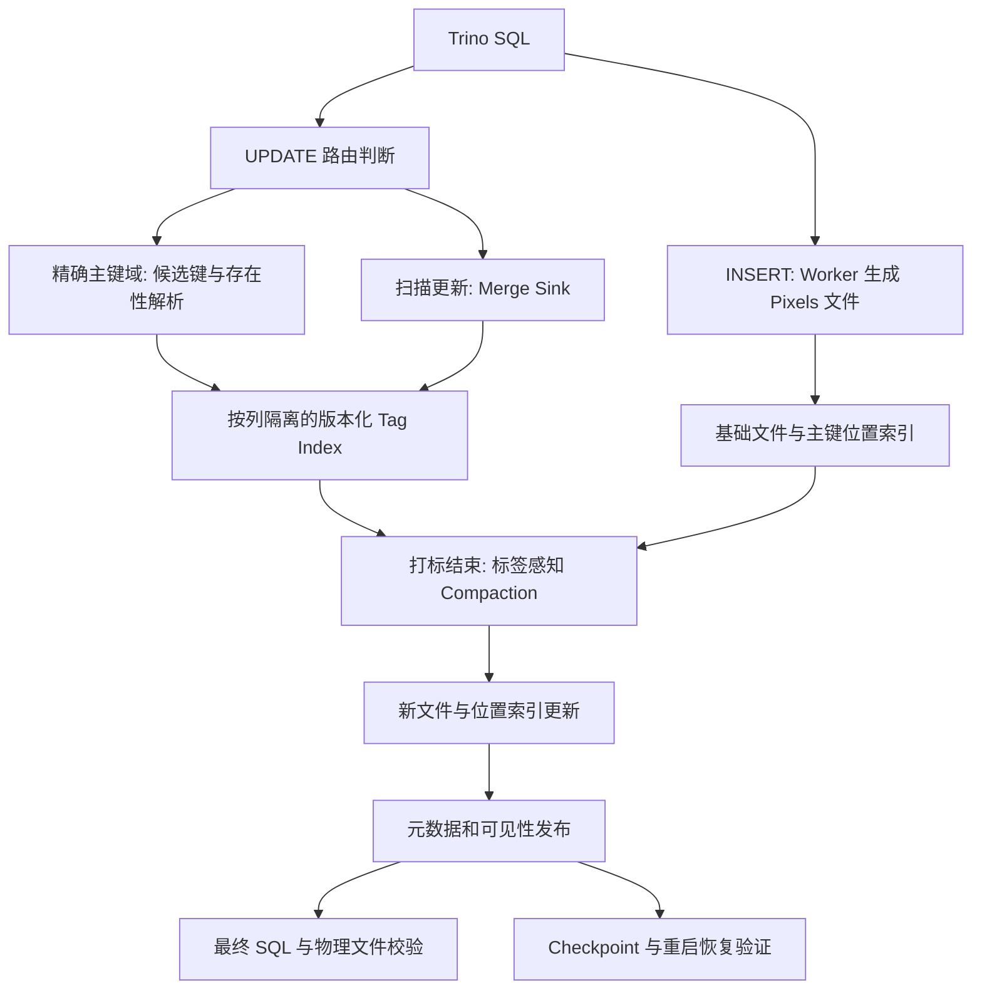

# 中国人民大学硕士学位论文开题报告（正文草稿）

## 课题名称

**面向大规模数据打标的列存系统增量更新与延迟物化机制研究**

英文题目：Incremental Updates and Deferred Materialization for Large-Scale Data Tagging in Columnar Storage Systems

> 版本日期：2026-11-23。本稿依据项目原始会议、68 列测例规范、最新代码及实验记录整理，
> 学校：中国人民大学；学位层次：硕士。本稿围绕选题依据、国内外研究现状与
> 研究方案组织正文，补充研究基础、进度和参考文献。具体学院、学硕/专硕类别、
> 封面、审核表、字数与排版要求尚未确认，不能视为已通过学院模板核验。
> 工程证据固定到 `codex/million-update-validation`：
> Pixels `15769b92d4ab699065685fb4935d6c0bc6750362`、
> Trino Connector `34199d5ec6136c7a81301514e391fa49eadd025d`。
> 本次编写核对了代码、仓库实验记录及公开文献，没有重新运行远程压测。
> 已有结果、待验证假设和拟开展工作在正文中分别说明。

## 摘要

大规模数据打标需要对宽表中的标签属性进行批量赋值，并通过标准 SQL 完成数据导入、
标签更新与最终结果查询。列存系统适合分析型读取，但以不可变文件组织数据时，行级
更新通常需要额外的增量记录、索引维护或文件重写。对于打标期间不查询、全部打标
完成后统一比对的业务，立即物化每次标签变化可能产生可避免的重复处理成本，而延后
物化又会引入索引积累、主键定位、文件重写与恢复一致性问题。

本课题以 Pixels 与 Trino 为实验平台，研究标签增量记录和最终列存物化相分离的更新
机制。通过 Trino Connector 接入 INSERT 和 UPDATE，使用 RocksDB 支撑按标签列
隔离的版本化增量索引，并在打标阶段结束后将变更合并到列存文件。研究重点包括实际
匹配集合的正确解析、共享主键集合的批量处理、合并与索引位置更新的协同，以及跨
打标周期和服务重启的状态一致性。在此基础上，构建覆盖更新列数、行分布、更新轮数
和表规模的评测矩阵，分别测量 SQL 提交、物化可见和完整周期成本，并与内部 Retina
路径及同查询引擎下的外部方案进行对照。

目前已具备百万行标签更新、合并后查询和特定配置下重启读回的实验基础，也发现并
修复了缺失主键误打标、合并后索引位置陈旧和 decimal 编码错误。现有证据尚不能证明
稳定的百万行每秒吞吐或所有工作负载上的优势。预期成果是形成具有明确语义边界的
更新与物化实现、可复现的实验体系，以及对适用条件、性能瓶颈和扩展边界的实证结论。

**关键词：** 列式存储；数据打标；SQL 行级更新；增量索引；延迟物化；性能评测

## 一、选题依据：技术背景、问题来源与研究意义

### 1.1 列式存储及其更新问题

数据库既可以按行组织数据，也可以按列组织数据。行式布局倾向于将一条记录的多个
属性存放在一起；列式布局将相同属性的值集中组织，便于分析查询按需读取少数列，
并利用相近的数据类型和值分布进行编码与压缩。以本课题的68列宽表为例，统计某个
标签的分布通常只需要该标签列和过滤条件涉及的列，无须总是读取整行全部属性。
这也是列式布局适合大规模扫描和聚合分析的重要原因。C-Store 对面向读取优化的
列式数据库设计进行了系统探索。[文献1](https://dl.acm.org/doi/10.5555/1083592.1083658)

读取优势不意味着行级修改没有代价。对于以不可变列式文件作为基础数据的系统，
修改某一行的标签通常不能简单覆盖文件中的一个字节区间，还可能涉及压缩块、
版本、索引和并发可见性。系统需要采用文件重写、额外增量记录或读时合并等方式
表达修改。不同机制将成本分配到写入、读取和后台维护的不同阶段。

因此，“列式存储”描述的是数据组织方式，不是一个具有统一 UPDATE 语义的产品
类别。分析本课题前，需要区分文件格式、表格式、查询引擎与完整数据库系统。

### 1.2 Pixels：本课题改造的列存基础

Pixels 是面向数据湖与数据仓库的列式存储引擎，其核心包括列式文件格式、读写
组件以及相关存储访问能力。Pixels 的研究工作关注云数据湖上的列存组织；其项目
实现支持与 Trino 等查询引擎集成，并提供元数据、索引、缓存和数据同步等组件。
[Pixels论文，文献2](https://doi.org/10.1109/ICDE53745.2022.00276)、
[项目说明](https://github.com/LeaseQ/pixels-dml/blob/15769b92d4ab699065685fb4935d6c0bc6750362/README.md)

本文区分两个语境：“Pixels 文件格式”指磁盘或对象存储中文件内部的数据组织；
“Pixels 系统”指围绕格式构建的读写器、元数据、索引及服务组件。本课题涉及的是
后者的更新与物化链路，不能仅以文件压缩率或扫描性能评价其 SQL 更新能力。

与课题直接相关的组件及分工如下：

| 组件 | 职责 | 本课题中的作用 |
| --- | --- | --- |
| Pixels Reader/Writer | 读取与生成列式文件 | INSERT生成文件；合并时读取旧值、输出新值 |
| 元数据服务 | 维护表、布局、文件等信息 | 确定有效输入与合并后输出的发布状态 |
| 主键索引与位置索引 | 解析主键到行标识、文件及行位置的关系 | 判断实际存在集合；合并后更新位置 |
| Retina | 原有数据变更回放及可见性、恢复相关能力 | 提供内部对照，并参与当前文件可见性与恢复流程 |
| 标签索引与标签感知Compaction | 本项目扩展的增量记录和物化路径 | 保存标签变更，在打标结束时写回列存文件 |

选择 Pixels 的原因在于项目需求和已有工程基础，而不是预先认定它在所有负载下
优于其他列存方案。已有存储布局和读取优化为研究提供平台，但标签更新、位置
维护和恢复仍是需要专门论证的问题；原系统的读取成绩不能直接充当本课题的写入
性能证据。

### 1.3 Trino：SQL 执行层与 Connector 改造入口

Trino 是分布式 SQL 查询引擎。Coordinator 负责语句分析、执行计划与任务协调，
Worker 执行数据处理任务；Connector 将具体数据源映射到 Trino 的表、列及读写
接口。它与 Pixels 的关系是执行引擎与存储系统的集成，而不是两种列式文件格式的
关系。[Trino概念文档，文献3](https://trino.io/docs/current/overview/concepts.html)

本项目使用 Trino 466 的 Pixels Connector。SQL 中的 INSERT 或 UPDATE 能否正确
执行，既取决于 Trino 的执行机制，也取决于 Connector 是否实现相应接口及底层
存储能否履行语义。当前 INSERT 由 Worker 通过 Pixels Writer 生成文件；UPDATE
按支持条件选择精确主键处理或扫描后的 Merge Sink 路径，再将标签变更交给 Pixels。
[Connector版本与集成说明](https://github.com/LeaseQ/pixels-trino-dml/blob/34199d5ec6136c7a81301514e391fa49eadd025d/README.md)

这一分工决定了性能分析必须跨越 SQL 执行、Connector、RPC、索引与文件物化。
例如，某次索引 RPC 很快，不代表查询调度、源数据读取、提交收尾都很快；标签
请求成功，也不代表普通文件扫描立即读到新值。后文将据此定义各阶段计时边界。

### 1.4 相关列式技术的层次与比较对象

Parquet 和 ORC 是常见的列式文件格式。Parquet 提供面向分析数据的列式编码与
压缩；ORC 以 stripe 等单元组织数据，并通过列级组织和索引辅助选择性读取。
它们首先规定文件如何存储和读取数据，单独的文件格式并不等于一套 SQL 更新、
事务提交和恢复协议。[Parquet文档，文献4](https://parquet.apache.org/docs/overview/)、
[ORC文档，文献5](https://orc.apache.org/docs/)

Iceberg、Hudi 和 Delta Lake 则在数据文件之上组织表状态及变更；ClickHouse 等
完整数据库还包含执行与服务能力。因此，本课题不能把这些名称与 Trino、Pixels
简单放入同一张“格式吞吐排名表”。对比需明确所在层次和被计量的工作。

| 层次 | 代表对象 | 主要研究问题 | 在本课题中的比较方式 |
| --- | --- | --- | --- |
| 列式文件格式/存储布局 | Parquet、ORC、Pixels格式 | 编码、压缩、列裁剪、I/O与扫描 | 用于解释读写成本；不能单独代表完整UPDATE能力 |
| 表格式与表管理机制 | Iceberg、Hudi、Delta Lake | 文件集合、版本、变更与提交 | 固定引擎、版本和可见语义后比较 |
| SQL执行引擎 | Trino等 | 计划、调度、算子与Connector接口 | 尽量固定引擎，减少执行层差异 |
| 完整列式数据库系统 | C-Store研究原型、ClickHouse等 | 存储、执行、更新与维护的综合设计 | 用于文献比较；实测时按整套系统评价 |
| 嵌入式键值存储 | RocksDB | 键值读写、索引与持久化 | 作为标签索引实现组件及局部诊断对象 |

表中分类用于说明比较边界，并不意味着 Pixels 只属于文件层；本项目恰好需要
将其文件、索引、服务与 Trino 执行层连接起来。主要外部实验选择同版本 Trino
上的 Iceberg，是为了尽量控制执行引擎变量，不是因为其内部机制与本方案相同。

### 1.5 业务背景与问题来源

本课题来源于数据打标项目的实际需求。业务首先导入包含主键、采集时间和业务维度
的基础数据，再利用 SQL 为大量行设置标签，最后对打标结果进行查询和比对。原始
会议明确：打标期间不查询，结果在全部打标完成后统一使用，对严格在线 ACID 的
要求宽松。因此，系统有机会将多个逻辑更新积累起来，集中完成物理文件重写。

会议提出的原始技术路线是：INSERT 在 Trino Worker 中使用 Pixels Writer 直接生成
文件，避免走 Retina 整行回放；UPDATE 将标签值到主键集合的映射记录在 RocksDB
中；完成打标后通过 CLI 或 RPC 触发 Compaction，将增量标签写入新文件。这一路线
不要求底层文件支持原地更新，但仍需维护主键位置、元数据和文件可见性。

这里的“不走整行回放”不等于完全脱离 Retina 服务。当前实现仍依赖相关服务维护
文件可见性与恢复状态。宽松事务要求也不免除实际匹配行数正确、最终标签正确和
已发布数据可恢复等基本要求。

### 1.6 核心矛盾

延迟物化能够降低打标阶段立即重写文件的频率，但并不自动降低整个流程成本。一次
UPDATE 可能需要枚举候选键、解析实际存在集合、编码标签并写入索引；最终合并还
需要读取文件、定位主键、应用最新标签、生成新文件、更新位置索引并发布可见性。
如果这些额外成本过高，较快的 UPDATE 返回速度可能掩盖较慢的最终结果交付。

因此，本课题的核心问题是：**在保证打标结果正确且可恢复的前提下，标签增量与
延迟物化能否降低完整打标周期的时间及资源成本，优势在什么条件下成立？**

研究不将“少列、多轮、连续主键”预设为所有业务的共同特征，也不将百万行每秒
视为行业统一标准。这些应分别作为工作负载变量和工程探索目标，通过实验检验。

### 1.7 研究意义

工程上，本课题使既有列存引擎能够承接标准 SQL 的数据导入和标签更新，减少业务
使用专用接口的成本，并提高批量打标流程的可观测性与可复现性。

研究上，本课题围绕增量表示、主键定位和物化开销之间的关系，分析何时延迟合并
能够减少重复工作、何时索引与重写成本会抵消收益。研究价值体现为明确的语义契约、
可解释的优化以及适用边界，不能仅以使用 RocksDB 或调整线程数作为创新结论。

## 二、国内外研究现状与文献述评

### 2.1 列式数据库与数据湖布局研究

C-Store 将列式布局、读取优化和面向写入的处理纳入系统设计，说明列存更新需要
在整体架构中考虑，而不是把行存接口直接附加在压缩文件之上。其设计为分析读写
分工提供了基础，但不能直接回答本项目跨 Trino、索引服务和文件发布的协调问题。
[文献1](https://dl.acm.org/doi/10.5555/1083592.1083658)

Pixels 及相关数据湖研究关注列式布局和缓存。Jin等的工作讨论跨行组布局优化和
面向分析访问的列缓存，体现了以实际访问模式改善I/O效率的思路。此类工作为
本项目的数据读取与重写提供基础，但其主要研究问题并非标签更新的实际匹配语义、
多轮物化和恢复，因而不能直接推导本课题的性能或正确性结论。
[Pixels论文，文献2](https://doi.org/10.1109/ICDE53745.2022.00276)、
[布局与缓存研究，文献6](https://doi.org/10.48786/edbt.2022.33)

在完整数据库层面，ClickHouse 的官方资料讨论了面向分析场景的更新以及异步或
读时处理等取舍。它说明列式系统并非普遍“不支持更新”，而是需要选择修改的表示
和生效方式。比较时必须固定实际版本与更新机制，不能把某一种 mutation 路径的
特点当作所有列式数据库更新方式的共同结论。
[ClickHouse更新概述，文献7](https://clickhouse.com/docs/concepts/features/operations/update/overview)

### 2.2 湖仓表格式中的增量更新与物化

不可变列式文件上的行级变更，需要在文件组织之外表达修改。Delta Lake 通过事务
日志管理云对象存储上的表状态，为分析数据提供事务化存储能力；这说明文件格式、
表状态管理和执行引擎需要协同，单纯比较文件编码并不能评价完整更新机制。
[Delta Lake 论文，文献8](https://dl.acm.org/doi/10.14778/3415478.3415560)

Apache Iceberg 的规范定义了按文件位置和按列值表达删除的机制；其实际使用方式
受表格式版本及执行引擎能力约束。因此，课题的外部实验应比较固定版本的完整
“引擎＋表格式”组合，而不能把所有格式能力都视为当前 Connector 已经支持。
[Iceberg 规范，文献9](https://iceberg.apache.org/spec/)

Apache Hudi 的 Merge-on-Read 将增量变更与基础文件分开保存，并可在查询时合并，
随后通过 Compaction 形成新的基础文件。与之相比，本课题当前普通扫描依赖先完成
标签物化。这一可见性差异必须在对照中披露，不能要求对方先做本来不需要的合并，
再计算其完成时间。[Hudi 官方文档，文献10](https://hudi.apache.org/docs/table_types/)

### 2.3 键值索引与批量处理

RocksDB 为持久化键值索引提供工程基础，但使用它并不能保证系统端到端高吞吐。
RocksDB 的长期工程经验表明，优化关注点会涉及写放大、空间、CPU 和资源管理等
多个方面，性能瓶颈需要结合实际负载测量。本课题还引入了序列化、RPC、主键版本
解析和位置索引协调，必须区分这些成本，避免将所有延迟归因于底层写入。
[RocksDB 工程经验，文献11](https://www.usenix.org/conference/fast21/presentation/dong)

拟研究的批量与并行处理也不是无条件增加并发：只有在可独立处理的请求之间建立
有界并行，保持版本、顺序与错误传播契约，才可能将组件级收益转化为可用的 SQL
性能改善。共享主键表示可以减少重复传输和复制，但其收益仍需在多列负载下验证。

### 2.4 评测方法

LST-Bench 提出将不同使用模式组合为工作负载，评估表格式与处理引擎共同作用下
的表现。本课题借鉴这一思路，将导入、更新、查询可见和维护组织为完整实验流程，
关注重复运行与不同负载组合，而不只报告单个 RPC 的最好值。
[LST-Bench 论文，文献12](https://dl.acm.org/doi/10.1145/3639314)

Trino 的当前 Iceberg Connector 文档提供数据管理能力，可作为同引擎外部对照的
候选依据；实验前仍须核验项目部署的 Trino 466 及其具体配置，不能将当前文档直接
当作旧版本的能力证明。[Trino 官方文档，文献13](https://trino.io/docs/current/connector/iceberg)

### 2.5 研究现状述评与本课题切入点

上述研究分别覆盖列式数据布局、表级变更管理、键值索引和综合评测。它们共同
表明，优化分析型更新需要同时考虑数据表示、可见性和维护成本。现有方法为本
课题提供了设计参照，但不能由这些方法的一般有效性推断本项目实现已经具有优势。

| 研究方向 | 已有工作的主要贡献 | 本课题需要进一步回答的问题 |
| --- | --- | --- |
| 列式布局与缓存 | 降低读取数据量并改善I/O效率 | 打标带来的标签记录、主键解析和重写成本如何分配？ |
| 湖仓增量与表状态管理 | 在文件上层表达变更、版本及可见性 | 在允许延后查询的条件下，集中物化能否降低完整周期成本？ |
| 键值索引与批量处理 | 支撑持久化索引并优化局部读写 | 多列共享、版本查询及跨服务调用会产生多少额外代价？ |
| 综合工作负载评测 | 联合评价引擎、表格式和维护行为 | 如何构造具有相同最终结果的打标对照并解释收益边界？ |

本课题的定位不是提出一种全面替代现有湖仓格式的方案，而是在 Pixels 上验证一种
面向延后查询打标任务的更新组织方式。需要回答其相对于原有路径和外部方案的收益、
代价与适用范围，允许实验得出某些场景不占优的结果。

## 三、研究目标与关键问题

### 3.1 总体目标

构建支持 SQL INSERT、标签 UPDATE 和延迟物化的可验证系统，在不要求底层列存
文件原地更新的条件下，保证标签赋值和最终查询结果一致，研究其完整周期成本，
并形成可解释、可复现的性能优化与评测方法。

### 3.2 具体研究问题

| 编号 | 研究问题 | 判定依据 |
| --- | --- | --- |
| RQ1 | 如何将 SQL 候选域正确转化为实际匹配行，并保持多列与多轮赋值语义？ | 缺键、空匹配、类型转换、覆盖更新及两条执行路径的结果对照 |
| RQ2 | 主键批量解析、共享表示和有界并行能否降低 UPDATE 成本？ | 固定数据与配置的配对消融，区分内部耗时与完整 SQL wall time |
| RQ3 | 延迟物化何时降低全周期成本，何时受文件重写或索引位置更新限制？ | 不同列数、轮数、更新比例和分布下的周期时间、写放大与内存 |
| RQ4 | 重复打标与服务重启后，如何保持标签、文件、位置索引和可见性一致？ | 干净流程重复验证、重启读回及限定故障点注入 |

### 3.3 范围与目标边界

首期范围包括 INSERT、标签常量赋值、精确主键 UPDATE、已支持的扫描更新路径、
标签感知 Compaction 和恢复验证。DELETE、任意复杂更新表达式、完整跨服务原子
事务及任意并发读写，不作为已经完成的能力。

原始会议提出“点查无需回表”，需要进一步拆分查询契约：仅返回主键与标签值的
覆盖查询，与返回任意基础列的完整行查询是不同能力。当前代码中定位文件再读数据
不等于索引覆盖查询；本报告不将通用无需回表查询列为已完成成果。

工程上探索稳定的几十万行每秒 SQL 吞吐，并研究接近百万行每秒的条件；这些目标
必须附带硬件、数据分布、列数和完成语义。论文的核心验收是语义正确、证据完整与
优化效果可解释，不能通过省略必要工作或选择最好样本满足吞吐目标。

## 四、研究内容与技术路线

### 4.1 系统总体结构



图中元数据、索引和可见性发布表示多个协调步骤，不表示当前已有跨服务原子提交。
该结构沿用会议确定的主线，拟开展的优化优先限制在表示、批量处理和物化实现内部；
若需要更换主要索引组织或整体写入架构，应另行论证并与项目负责人讨论。

### 4.2 SQL 匹配语义与类型一致性

精确主键路径不能将有限谓词枚举得到的候选键数直接作为更新行数。例如表中仅有
主键 1 和 3，对范围 1～3 更新时应影响两行，不能给缺失键 2 预先留下标签。
本课题将候选域、实际存在集合和实际更新集合分别建模，统一校验返回计数与最终值。

扫描更新路径使用 Trino 提供的数据块和值类型，必须与精确路径采用一致的标签
编码。重点覆盖 decimal 的精度与 scale、字符串、NULL 以及同一行不同列独立赋值。
路由选择与不支持的操作应可观测，不能以静默降级掩盖语义差异。

### 4.3 标签增量表示与批量解析

现有 Tag Index 按列区分标签值，记录主键集合及版本信息。同一批行的多列赋值可
共享主键列表，从而减少重复序列化和中间复制。后续通过 2、8、60 列对照，测量
共享表示对网络字节、对象分配、峰值内存和 SQL 时间的实际贡献。

主键解析采用保持语义的批量接口，在语句快照下选择有效版本。对独立批次研究
有界并行与背压，分别统计主键查找、位置解析、编码和 RPC 等待。已有存在性过滤
必须保留，不能用跳过检查的方法换取性能。进一步的轻量接口设计应先证明不会将
索引损坏或位置缺失误当作正常不存在。

### 4.4 标签物化、文件选择与索引位置更新

Compaction 需要将标签快照应用到当前有效数据文件，输出新文件并更新行位置。
重复打标时，输入必须能够覆盖上轮已经生成的 compact 文件，而不能永久只处理
初始 ordered 文件。位置更新还需使新的映射替换旧映射，防止查找顺序决定实际
返回哪个文件。

后续先完善这一正确流程，再研究按受影响文件或分区组织物化。需要同时记录修改
行数、触及文件数与实际重写文件数：随机稀疏更新可能仍触及多数文件，不能仅由
低修改比例推断物理写入量会小。

在工程实现上，优先验证索引解析与文件读写重叠、独立 vnode 位置更新并行等措施。
应限制在途任务数量和待处理数据量；仅限制每个 RPC 的条目数，不足以保证整体
内存有界。现有全量标签快照和映射仍需测量，不能把流式 RPC 当作有界物化的证明。

### 4.5 发布与恢复一致性

将一个打标周期的状态划分为：标签已记录、文件已物化、位置已更新、结果已发布、
checkpoint 已覆盖。研究每个状态的可观察证据、失败后的重试行为，以及旧文件的
安全回收条件。语句返回成功、普通查询看到新值和重启后仍能恢复，是不同事件。

当前重点验证同时间戳的可见性变化、checkpoint 快照与版本确认的一致性、body
写入中断以及主索引持久化范围重叠。正常 recovery epoch readiness 握手作为生命周期
步骤记录；人工修改元数据或修复文件的诊断运行不得作为干净恢复验收。

## 五、研究方法与实验方案

### 5.1 方法与成本拆分

采用“语义定义—分段测量—假设提出—单变量对照—完整流程验证”的方法。对已有
实现进行源码分析与运行剖析，使用 query timeline、阶段埋点、JFR、GC/RSS 和
存储统计定位瓶颈。微基准用于解释组件行为，SQL 与完整周期实验用于判断实际收益。

对串行组织的打标任务，可写为：

`T_cycle = Σ T_update_wall + T_materialize_and_publish_wall`

若包含初始导入，再单独报告 `T_load`。存在重叠时，以实际端到端 wall time 为准，
不直接相加并发任务的累计耗时。对延迟合并的判断取决于多轮减少的重复处理成本，
是否超过标签记录、索引解析与最终物化的新增成本，而不是只比较 UPDATE 提交速度。

### 5.2 数据集与负载设计

主测例采用项目约定的 68 列宽表：`id bigint`、`cap_time timestamp`、3 个 integer
维度、3 个 `decimal(38,2)` 维度，以及30对 `varchar(10)` 与 `decimal(18,4)` 标签。
初始仅前8列有值，60个标签列应为 SQL NULL。历史 CSV 曾用空字符串表示部分标签，
正式测例须验证 loader 的 NULL 约定，不能把历史生成器视为已经合格。[工程证据E1]

| 维度 | 实验设计 |
| --- | --- |
| 基表规模 | 1M、10M；资源允许且前级验收通过后推进到100M，1B保留为扩展目标 |
| 修改规模 | 固定修改行数与固定修改比例两组，避免混淆全表规模影响 |
| 更新列数 | 2、8、60列，明确所有目标列已配置为受支持标签列 |
| 键分布 | 连续、随机、带孔洞、缺失键和空匹配 |
| 谓词/路由 | 精确主键、全表、时间/维度条件，记录真实 exact 或 fallback 路由 |
| 更新过程 | 一次多列、分轮更新不同列、同列反复覆盖、跨多个物化周期 |
| 运行状态 | 新表首次初始化、重启后已有表、定义清楚的预热后运行 |

规模实验不要求每个维度做完整笛卡尔积。先用小表覆盖语义，再在1M上完成核心
性能矩阵，最后选择有代表性的配置扩展。单语句候选键上限与基表规模分别披露。

### 5.3 决定性对照与消融

1. **延迟合并价值：** 对同一初始数据，比较一次更新60列与30次各更新两列后只
   合并一次，要求最终结果一致；另设同列多轮覆盖，评估旧版本积累。
2. **具体优化贡献：** 在同语义、同资源下比较解析串行/有界并行、主键重复/共享
   表示、位置更新串行/并行；记录阶段收益和是否转化为整体收益。
3. **内部基线：** 与原 Retina 整行回放路径比较相同逻辑变化和最终结果，披露接口
   与执行链路差异，并验证其成本是否随更新列数变化。
4. **外部基线：** 优先使用相同 Trino 版本的 Iceberg，先核验功能再部署；统一
   硬件、存储、输入数据和最终查询目标，报告事务与持久性差异。
5. **规模与长期运行：** 在多轮运行中记录历史索引、文件数、内存与尾延迟的增长，
   判断是否存在工作积压和性能退化。

外部对照不能强制所有系统使用相同内部算法。若基线提交后已可查询新值，其结果
可见计时到此结束；本方案必要的 Compaction 必须计入。后续维护开销和优化布局后
的查询性能另列，不把代价移出统计窗口。Hudi 等跨引擎实验可作为可选扩展，不能
将整套系统差异直接归因于格式。

### 5.4 评价指标与统计规则

| 指标 | 定义与边界 |
| --- | --- |
| SQL 吞吐 | 实际修改行数 / 客户端提交至完成的 wall time；另列 Trino elapsed |
| 内部处理速率 | 组件处理量 / 对应阶段时间，仅用于诊断，不能替代 SQL 吞吐 |
| 物化与全周期成本 | 必要合并、位置更新和发布耗时；完整周期单独计时 |
| 工作量 | 不同受影响行数、累计行更新次数和累计单元格赋值次数分别报告 |
| 写放大 | 周期内物理写入字节 / 明确定义的逻辑变更字节，注明索引、日志、文件范围 |
| 资源占用 | CPU、峰值 RSS、堆与 GC、存储增量、RPC 数量及传输字节 |
| 结果与恢复 | 行/列值、缺键行为、位置映射、物理文件结果与重启后结果一致 |

各核心性能配置至少重复3次，保留所有样本并报告中位数和波动；样本不足时不估计
可靠的P95/P99。采用配对或交替运行控制状态漂移，差异落在噪声内则不宣称收益。
异常、超时和人工修复的运行单列，不因其成绩差而删除。

每次实验保存两个仓库 SHA、部署 jar 校验值、有效 JVM 参数、表 DDL、数据种子、
输入校验、精确 SQL、query ID、计时边界和原始日志。表路径采用单一 root URI，
确认主键索引属性与实际生效的分组/并行配置，避免复用错误 DDL 造成虚假对照。

### 5.5 正确性与恢复验收

首先构造小规模参考结果，逐键逐列比对，覆盖缺失键后续插入、不同列隔离、同列
覆盖、NULL、decimal 正负值和边界值。大规模使用确定性期望值、错误行计数、
主键去重与物理文件交叉检查；仅 count/min/max 不能证明标签完全正确。

核心验收流程为：

```text
干净建表与 INSERT
→ 第一轮 UPDATE → COMPACT → SQL/物理文件核对
→ 第二轮 UPDATE → COMPACT → SQL/位置索引核对
→ checkpoint → Retina/索引服务重启 → readiness → 再次核对
```

分别对 exact 与 fallback 执行，并增加“多轮 UPDATE 后仅合并一次”的流程。
在此基础上对限定失败点做故障注入，验证失败能被检测、可重试且不会静默丢失
已承诺的数据。当前并未证明完整在线 ACID，不以此作为已具备能力。

## 六、已有工作基础与阶段性证据

### 6.1 已有实现

已形成 Trino DML 接入、按列隔离的标签索引、共享主键协议、标签感知 Compaction
和恢复验证基础。近期修复与优化包括：候选键存在性过滤、批量 iterator 复用、
解析并行化、位置更新并行化、减少映射复制、重复合并输入扩展、旧位置缓存清理，
以及 exact/fallback 两条路径的 decimal scale 处理。[工程证据E2—E4]

这些工作为研究提供了可运行平台，但各项证据范围不同。功能修复、组件测试、
SQL 性能和重启验证不互相替代，已尝试但无稳定收益的优化不计为有效贡献。

### 6.2 可引用结果及其限制

| 实验记录 | 结果 | 解释边界 |
| --- | --- | --- |
| candidate8：68列、百万行、两列打标 | INSERT 12.216s Trino / 14.289s shell；UPDATE 11.723s / 13.592s；合并后正常重启读回通过 | 较早配置的单周期证据，不能代替后续修改的恢复验收 |
| exact 主键解析并行对照 | p1：9.545s Trino elapsed；p16：2.445s，约10.5万→40.9万行/秒 | 保留存在性检查；特定配置实验，不是所有谓词的稳定成绩 |
| 2M表的位置更新并行对照 | 相同源布局、解析p8，relocation p1约25s，p8两次约15s COMPACT | 支持该配置的局部收益，不能跨不同布局推算统一加速比 |
| 8M表、修改1M行 | p8/p8 COMPACT约55s，最终行数、唯一键和标签检查通过 | 扩展性样本，未证明100M/1B或最新代码的完整恢复 |
| candidate83标准root布局流程 | 1M INSERT 15.546s shell，UPDATE 3.854s，COMPACT 45.365s | 单次完整物化记录；INSERT尚有较大状态差异 |
| 重复打标及fallback decimal修复后 | 1M全表UPDATE约33s，COMPACT约82s；SQL与直接文件读回为U86/86.0000 | 基于既有表及修复性合并，不能替代干净的重复周期加重启验收 |
| 最新共享列表/数组解析候选 | 5次Connector内部总时间2.596、1.809、1.733、2.161、1.756s | 换算约38.5万～57.7万行/秒内部速率，没有同批完整SQL/周期成绩 |

上述数字来自固定提交中的实验记录，不是本次独立复测；不同实验的表规模、数据
状态、运行配置和时间口径不同，不能按大小直接排名。[工程证据E2、E3]

最新记录中对内部吞吐的概括与列出的5个样本存在出入，本报告采用可复算的样本
数值，不沿用“0.55～0.65M稳定吞吐”的表述。对 iterator 复用、共享列表等措施，
已有组件收益不等于稳定 SQL 加速，更不等于百万吞吐达标。

部分近期诊断实验的源表已经带有 `AAA` 等非空标签，其结果可用于验证覆盖更新或
未修改列的保留，但不等于符合“初始60个标签列全为NULL”的统一主测例。正式对照
应重建并校验输入，不能因结构同为68列就认定所有样本具有相同数据条件。

### 6.3 近期正确性发现的研究启示

缺失主键误打标表明，SQL 候选枚举不能替代实际匹配语义；合并后索引仍指向旧文件
表明，重写完成不等于位置索引和可见性已一致；fallback decimal 错误表明，一条
快路径通过并不能代表所有 SQL 路由正确。因此，语义、物化和恢复应作为性能实验
的前置条件，而不是在吞吐优化结束后补验。

重复打标目前已有运行中修复证据，但持久化 SQLite 范围重叠在重启后的行为仍待
确认。checkpoint generation 与实际快照可能错配、同时间戳覆盖已发布 body 的
中断窗口，以及异步解析在途数据增长，仍需专项测试；这些静态风险尚未在本次
工作中做故障注入，不能写成已经复现或修复的结果。

### 6.4 当前结论

现阶段具备继续研究的工程基础，局部并行化也有可解释收益，但尚未证明完整打标
周期相对外部基线具有优势。INSERT 的稳定基线、扫描更新性能、跨周期恢复和大
规模内存增长仍是重要限制。后续应优先把干净的重复流程及其成本固定下来，而非
继续以单次最好吞吐驱动方向选择。

## 七、拟形成的研究贡献

1. **面向标签打标的语义与实现。** 形成候选域、实际存在集合、按列赋值和最终
   物化之间的明确契约，并在 Trino/Pixels 上完成可验证实现。
2. **有界批量处理与物化协同。** 研究共享主键表示、解析并行、文件重写和位置
   更新的组合，在保证正确性的前提下说明收益、资源代价及规模限制。
3. **可恢复的跨周期状态协调。** 围绕文件、位置索引、可见性与 checkpoint，给出
   状态转换、异常检测和恢复验证方法，形成可重复的反例与修复证据。
4. **完整周期评测与适用边界。** 建立能区分提交速度、物化代价和结果可见性的
   评测体系，通过外部比较和内部消融回答方案何时值得采用。

以上是拟形成的贡献，不能预先写成已证明的新算法或普适优势。最终论文应据实验
收敛贡献范围：若某些负载全周期不占优，应报告原因和交叉点，并调整设计结论。

## 八、可行性、风险与应对

已有两个可构建仓库、68列测例规范、隔离运行环境、百万行及部分800万行实验记录，
具备开展增量研究的基础。现阶段不宜同时重做全部存储架构，应围绕已定位的关键
问题，采用小范围改动、配对验证和逐级扩大规模的方式推进。

| 风险 | 应对与决策条件 |
| --- | --- |
| 重复打标或重启仍出现旧位置/旧标签 | 先完成小表逐键复现与干净流程，正确性未通过不推广性能结论 |
| 多轮后索引和内存持续增长 | 限制在途数据并测量历史版本成本；需要改变索引组织时单独评审 |
| SQL局部加速被合并成本抵消 | 以全周期和写入字节为主要取舍依据，讨论文件/分区级处理 |
| 实验状态漂移或部署包混用 | 固定fixture、SHA与jar校验，核验生效参数，保留原始日志和失败样本 |
| 外部方案能力或配置不匹配 | 先验证版本与语义，披露差异，禁止把不等价运行直接排序 |
| 资源或时间不足 | 优先完成1M/10M代表性矩阵及可复现报告，100M/1B列为扩展，不虚报成果 |

若代表性负载的全周期时间、写放大和资源占用均无优势，应重新评审增量表示或
合并策略；若仅部分条件占优，则明确收窄适用范围。架构取舍由实验决定。

## 九、进度安排与阶段验收

采用相对里程碑安排，具体周次应结合学校开题与答辩时间调整，不假设既定毕业日期。

| 阶段 | 建议安排 | 交付与验收 |
| --- | --- | --- |
| 需求与基线固化 | 第1—2周 | 完成文献与语义边界；固定NULL正确的fixture、运行包及计时脚本 |
| 正确性与恢复 | 第3—4周 | 补齐缺键、两次物化周期、decimal/NULL、重启与重点故障点验证 |
| 1M性能与外部对照 | 第5—6周 | 完成关键消融，部署验证外部基线，报告重复样本与全周期成本 |
| 规模与多轮研究 | 第7—8周 | 10M实验、多轮覆盖、写放大和内存增长；选择是否推进更大规模 |
| 结果整理与论文 | 第9—10周 | 固化复现实验，完成图表、边界分析、论文初稿及修改计划 |

前后阶段可适度交叉；进入规模实验前必须完成对应正确性验收。若周期受限，
压缩可选大规模与跨引擎扩展，优先保留完整对照和证据质量。

## 十、预期成果与论文结构

预期交付：硕士学位论文、可构建的代码版本、数据生成与验证工具、固定配置及运行包
清单、原始实验记录、对照/消融图表和已知限制说明。最大规模、吞吐与恢复能力
均以实际完成的验证为准。

论文拟分为六章：绪论与问题定义；相关技术与研究现状；增量标签更新机制；
物化、索引位置与恢复一致性；实验设计与结果分析；总结及局限。实现细节服务于
研究问题，commit 日志与完整参数可放入附录，不替代正文论证。

## 十一、参考文献

1. Stonebraker M, Abadi D J, Batkin A, et al. C-Store: A Column-oriented DBMS[C].
   Proceedings of the 31st International Conference on Very Large Data Bases, 2005: 553–564.
   [论文](https://dl.acm.org/doi/10.5555/1083592.1083658).
2. Bian H, Ailamaki A. Pixels: An Efficient Column Store for Cloud Data Lakes[C].
   2022 IEEE 38th International Conference on Data Engineering, 2022.
   [DOI: 10.1109/ICDE53745.2022.00276](https://doi.org/10.1109/ICDE53745.2022.00276).
3. Trino. Trino Concepts[EB/OL]. 访问日期：2026-11-23.
   [官方概念文档](https://trino.io/docs/current/overview/concepts.html).
4. Apache Parquet. Overview[EB/OL]. 访问日期：2026-11-23.
   [官方文档](https://parquet.apache.org/docs/overview/).
5. Apache ORC. Background[EB/OL]. 访问日期：2026-11-23.
   [官方文档](https://orc.apache.org/docs/).
6. Jin G, Bian H, Chen Y, Du X. Columnar Storage Optimization and Caching for
   Data Lakes[C]. Proceedings of the 25th International Conference on Extending
   Database Technology, 2022.
   [DOI: 10.48786/edbt.2022.33](https://doi.org/10.48786/edbt.2022.33).
7. ClickHouse. Updates in ClickHouse[EB/OL]. 访问日期：2026-11-23.
   [官方文档](https://clickhouse.com/docs/concepts/features/operations/update/overview).
8. Armbrust M, Das T, Paranjpye S, et al. Delta Lake: High-Performance ACID Table
   Storage over Cloud Object Stores[J]. Proceedings of the VLDB Endowment, 2020,
   13(12): 3411–3424. [DOI: 10.14778/3415478.3415560](https://dl.acm.org/doi/10.14778/3415478.3415560).
9. Apache Iceberg. Apache Iceberg Table Spec[EB/OL]. 访问日期：2026-11-23.
   [规范](https://iceberg.apache.org/spec/). 实验须固定表格式及引擎版本。
10. Apache Hudi. Table & Query Types[EB/OL]. 访问日期：2026-11-23.
    [文档](https://hudi.apache.org/docs/table_types/).
11. Dong S, Kryczka A, Jin Y, Stumm M. Evolution of Development Priorities in
    Key-value Stores Serving Large-scale Applications: The RocksDB Experience[C].
    19th USENIX Conference on File and Storage Technologies, 2021: 33–49.
    [论文与会议资料](https://www.usenix.org/conference/fast21/presentation/dong).
12. Camacho-Rodríguez J, Agrawal A, Gruenheid A, et al. LST-Bench: Benchmarking
    Log-Structured Tables in the Cloud[J]. Proceedings of the ACM on Management
    of Data, 2024, 2(1). [DOI: 10.1145/3639314](https://dl.acm.org/doi/10.1145/3639314).
13. Trino. Iceberg Connector[EB/OL]. 访问日期：2026-11-23.
    [当前文档](https://trino.io/docs/current/connector/iceberg).
    仅用于机制与基线选型，Trino 466 能力须另行核验。

正式提交时按学校参考文献样式统一排版。公开文献用于技术定位，不作为本项目
已达到性能或正确性的证据。

## 附录A：工程证据索引

以下为项目工程记录，与同行评议文献分开列示。原始会议由用户提供并已在本地存档；
实验结论以具体配置、日志及完成范围为准。

- **E1 测例规范：** [68列数据与NULL契约](https://github.com/LeaseQ/pixels-dml/blob/15769b92d4ab699065685fb4935d6c0bc6750362/RFC_68COL_TAG_BENCHMARK.md)。
- **E2 历史验证与并行实验：** [百万行UPDATE、INSERT及持久化记录](https://github.com/LeaseQ/pixels-dml/blob/15769b92d4ab699065685fb4935d6c0bc6750362/RFC_MILLION_UPDATE_INSERT_DURABILITY.md)。
- **E3 最新正确性与性能记录：** [完整流程、位置修复、fallback decimal及共享主键候选](https://github.com/LeaseQ/pixels-dml/blob/15769b92d4ab699065685fb4935d6c0bc6750362/RFC_E2E_INSERT_UPDATE_COMPACT_CANDIDATE45_20261123.md)。
- **E4 映射复制优化：** [Compaction relocation map内存记录](https://github.com/LeaseQ/pixels-dml/blob/15769b92d4ab699065685fb4935d6c0bc6750362/RFC_COMPACTION_RELOCATED_MAP_MEMORY_20261123.md)。
- **E5 评估过程：** [优化方向与验证决策](optimization-direction-review.md)、[上一版开题核对](thesis-proposal-revised-20261122.md)。两份文档保留各自日期的历史判断，最新状态以本文固定快照及E3为准。

近期关键提交：Pixels `a9bed1e8`（重复合并输入）、`d5ccc1cb`（主索引位置替换）、
`15769b92`（解析数组与共享列表候选）；Trino `fa390c8`（解析并行化）、
`34199d5`（fallback decimal scale）。候选代码存在不等于所有实验门槛已通过。

## 附录B：开题编排依据与正式提交边界

本稿的学校与学位层次依据作者确认，采用硕士开题正文的论证方式。格式核对结果如下：

- 已查阅人大商学院公开的《商学院学术型研究生学位论文开题报告管理实施细则》
  （2021年修订）。其中硕士部分明确审查选题依据、研究方案及国内外研究现状，
  并区分开题报告书与申请/审核材料。该文件仅作为人大院系公开要求的参考，
  不作为本课题所属学院的直接规定；其中博士字数要求不套用到本稿。
  [官方细则](https://www.rmbs.ruc.edu.cn/jxxm/sb/sbgzzd/10073c5a004a4afdb4d380f300c90704.htm)
- 检索到人大信息学院“开题报告模版”官方页面，位于同等学力栏目；当前无法读取
  附件正文，且培养类别是否适用尚未确认。因此没有声称已采用该模板，也未据此
  指定最低字数、字号或签字栏目。
  [官方模板页面](http://info.ruc.edu.cn/rcpy/tdxl/xgxz5/d91e4b8c33fb43d3b9af19dbc7af6b42.htm)

为便于后续迁移到学院表格，正文内容对应关系为：

| 开题论证内容 | 本稿位置 |
| --- | --- |
| 选题依据、理论与实践意义 | 第一章，含列存基础、Pixels/Trino定位及业务问题 |
| 国内外研究现状与主要参考文献 | 第二章及第十一章，按技术路线分析而非罗列产品 |
| 研究内容、目标与拟解决问题 | 第三、四章 |
| 研究方法、技术路线和可行性 | 第四、五、八章 |
| 工作基础及预期贡献 | 第六、七章，区分已完成证据与拟研究内容 |
| 研究计划、预期成果与论文大纲 | 第九、十章 |

摘要、工程证据附录和本编排说明用于审阅便利，不声明为学校必填栏目。正式提交时
需按所属学院及学位类型核对封面、审核表、章节合并、参考文献顺序和版式；本稿可以
提供正文内容，但不代填导师意见、评审意见或签名。
