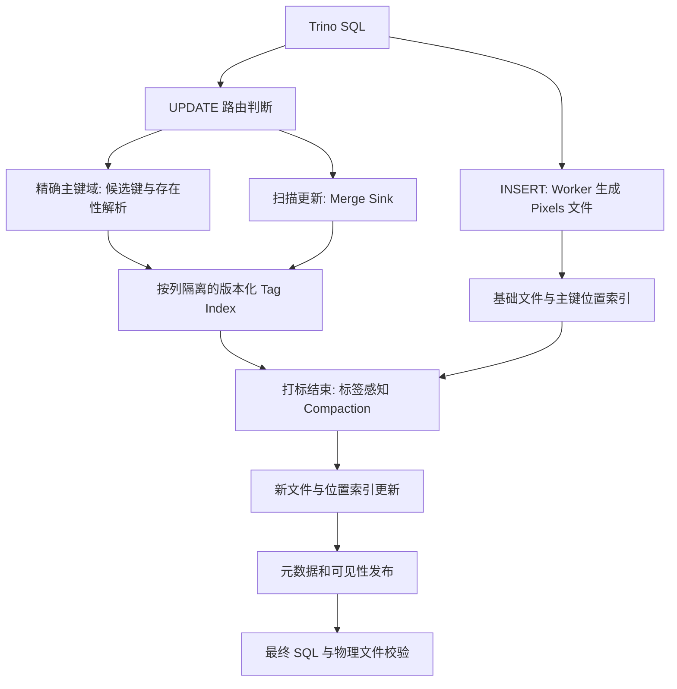

# 中国人民大学硕士学位论文开题报告（正文草稿）

## 课题名称

**面向大规模数据打标的列存系统批量插入与标签更新机制研究**

英文题目：Bulk Insertion and Tag Update Mechanisms for Large-Scale Data Tagging in Columnar Storage Systems

> 版本日期：2026-11-24（研究计划修订，保留原文件名以延续引用）。本稿依据项目原始会议、68 列测例规范、代码及实验记录整理，
> 本文件为唯一持续维护的开题报告主稿；早期草稿通过Git历史查阅，不再并行维护。
> 学校：中国人民大学；学位层次：硕士。本稿围绕选题依据、国内外研究现状与
> 研究方案组织正文，补充研究基础、进度和参考文献。具体学院、学硕/专硕类别、
> 封面、审核表、字数与排版要求尚未确认，不能视为已通过学院模板核验。
> 第六章工程证据保留2026-11-23的固定快照，不代表最新运行状态；其分支为 `codex/million-update-validation`：
> Pixels `15769b92d4ab699065685fb4935d6c0bc6750362`、
> Trino Connector `34199d5ec6136c7a81301514e391fa49eadd025d`。
> 本次编写核对了代码、仓库实验记录及公开文献，没有重新运行远程压测。
> 已有结果、待验证假设和拟开展工作在正文中分别说明。
> 2026-11-24范围确认：INSERT与UPDATE并列；百万吞吐为探索目标；主实验聚焦正常运行，
> 故障恢复不作为研究目标或性能验收门槛；先建立双路径总体对照，再选择优化。
> 本次修订区分开题论证与开题后实验，将鲲鹏服务器列为拟采用的主要实验平台。
> 外部方案的选择依据与实验设计纳入开题，部署和实测安排在开题后；本稿不将
> 完成Hudi/StarRocks实测作为开题前提，也不宣称穷尽最新SOTA或已完成鲲鹏测试。

## 摘要

大规模数据打标需要对宽表中的标签属性进行批量赋值，并通过标准 SQL 完成数据导入、
标签更新与最终结果查询。列存系统适合分析型读取，但以不可变文件组织数据时，行级
更新通常需要额外的增量记录、索引维护或文件重写。对于打标期间不查询、全部打标
完成后统一比对的业务，立即物化每次标签变化可能产生可避免的重复处理成本，而延后
物化又会引入索引积累、主键定位、文件重写与发布一致性问题。

本课题以 Pixels 与 Trino 为实验平台，并列研究批量插入与标签更新机制。INSERT
由 Trino Worker 直接生成 Pixels 文件，研究源读取、数据转换、文件写入、索引与
发布之间的成本关系；UPDATE使用RocksDB记录标签增量，在打标结束后物化，研究
实际匹配集合解析、批量处理与重写开销。主实验聚焦主键筛选、常量标签赋值及独立
多轮打标；非主键筛选与依赖更新先核对能力边界，不另开优化主线。

实验分别报告SQL完成时间、必要的最终可查询时间及资源成本，披露持久化配置与
计时范围，不将故障注入作为本课题验收条件。先核验内部基线的语义可比性，再开展
直接支持部分列更新的外部系统及同引擎方案对照。两条路径均需完整评估，允许收益
不对称，不预设每条路径都产生独立创新。

后续拟在鲲鹏服务器平台完成部署、正确性与性能实验。开题阶段论证研究问题、
方法差异、候选基线和实验可行性；外部系统部署及系统性对照在开题后开展。
同平台比较与内部消融用于分析方法收益，跨平台复现作为资源允许时的补充。

目前已具备百万行标签更新、合并后查询和特定配置下重启读回的实验基础，也发现并
修复了缺失主键误打标、合并后索引位置陈旧和 decimal 编码错误。现有证据尚不能证明
稳定的百万行每秒吞吐或所有工作负载上的优势。预期成果是形成具有明确语义边界的
批量插入、标签更新与物化实现、可复现的实验体系，以及对适用条件、性能瓶颈和扩展边界的实证结论。

**关键词：** 列式存储；数据打标；批量插入；SQL 行级更新；增量索引；延迟物化；性能评测

## 一、选题依据：技术背景、问题来源与研究意义

### 1.1 列式存储及其更新问题

数据库既可以按行组织数据，也可以按列组织数据。行式布局倾向于将一条记录的多个
属性存放在一起；列式布局将相同属性的值集中组织，便于分析查询按需读取少数列，
并利用相近的数据类型和值分布进行编码与压缩。以本课题的68列宽表为例，统计某个
标签的分布通常只需要该标签列和过滤条件涉及的列，无须总是读取整行全部属性。
这也是列式布局适合大规模扫描和聚合分析的重要原因。C-Store 对面向读取优化的
列式数据库设计进行了系统探索。[文献1](https://dl.acm.org/doi/10.5555/1083592.1083658)

读取优势不意味着行级修改没有代价。对于以不可变列式文件作为基础数据的系统，
修改某一行的标签通常不能简单覆盖文件中的一个字节区间，还可能涉及压缩块、
版本、索引和并发可见性。系统需要采用文件重写、额外增量记录或读时合并等方式
表达修改。不同机制将成本分配到写入、读取和后台维护的不同阶段。

因此，“列式存储”描述的是数据组织方式，不是一个具有统一 UPDATE 语义的产品
类别。分析本课题前，需要区分文件格式、表格式、查询引擎与完整数据库系统。

### 1.2 Pixels：本课题改造的列存基础

Pixels 是面向数据湖与数据仓库的列式存储引擎，其核心包括列式文件格式、读写
组件以及相关存储访问能力。Pixels 的研究工作关注云数据湖上的列存组织；其项目
实现支持与 Trino 等查询引擎集成，并提供元数据、索引、缓存和数据同步等组件。
[Pixels论文，文献2](https://doi.org/10.1109/ICDE53745.2022.00276)、
[项目说明](https://github.com/LeaseQ/pixels-dml/blob/15769b92d4ab699065685fb4935d6c0bc6750362/README.md)

本文区分两个语境：“Pixels 文件格式”指磁盘或对象存储中文件内部的数据组织；
“Pixels 系统”指围绕格式构建的读写器、元数据、索引及服务组件。本课题涉及的是
后者的更新与物化链路，不能仅以文件压缩率或扫描性能评价其 SQL 更新能力。

与课题直接相关的组件及分工如下：

| 组件 | 职责 | 本课题中的作用 |
| --- | --- | --- |
| Pixels Reader/Writer | 读取与生成列式文件 | INSERT生成文件；合并时读取旧值、输出新值 |
| 元数据服务 | 维护表、布局、文件等信息 | 确定有效输入与合并后输出的发布状态 |
| 主键索引与位置索引 | 解析主键到行标识、文件及行位置的关系 | 判断实际存在集合；合并后更新位置 |
| Retina | 原有数据变更回放及可见性、恢复相关能力 | 提供内部对照，并参与当前文件可见性与恢复流程 |
| 标签索引与标签感知Compaction | 本项目扩展的增量记录和物化路径 | 保存标签变更，在打标结束时写回列存文件 |

选择 Pixels 的原因在于项目需求和已有工程基础，而不是预先认定它在所有负载下
优于其他列存方案。已有存储布局和读取优化为研究提供平台，但标签更新、位置
维护和恢复仍是需要专门论证的问题；原系统的读取成绩不能直接充当本课题的写入
性能证据。

### 1.3 Trino：SQL 执行层与 Connector 改造入口

Trino 是分布式 SQL 查询引擎。Coordinator 负责语句分析、执行计划与任务协调，
Worker 执行数据处理任务；Connector 将具体数据源映射到 Trino 的表、列及读写
接口。它与 Pixels 的关系是执行引擎与存储系统的集成，而不是两种列式文件格式的
关系。[Trino概念文档，文献3](https://trino.io/docs/current/overview/concepts.html)

本项目使用 Trino 466 的 Pixels Connector。SQL 中的 INSERT 或 UPDATE 能否正确
执行，既取决于 Trino 的执行机制，也取决于 Connector 是否实现相应接口及底层
存储能否履行语义。当前 INSERT 由 Worker 通过 Pixels Writer 生成文件；UPDATE
按支持条件选择精确主键处理或扫描后的 Merge Sink 路径，再将标签变更交给 Pixels。
[Connector版本与集成说明](https://github.com/LeaseQ/pixels-trino-dml/blob/34199d5ec6136c7a81301514e391fa49eadd025d/README.md)

这一分工决定了性能分析必须跨越 SQL 执行、Connector、RPC、索引与文件物化。
例如，某次索引 RPC 很快，不代表查询调度、源数据读取、提交收尾都很快；标签
请求成功，也不代表普通文件扫描立即读到新值。后文将据此定义各阶段计时边界。

### 1.4 相关列式技术的层次与比较对象

Parquet 和 ORC 是常见的列式文件格式。Parquet 提供面向分析数据的列式编码与
压缩；ORC 以 stripe 等单元组织数据，并通过列级组织和索引辅助选择性读取。
它们首先规定文件如何存储和读取数据，单独的文件格式并不等于一套 SQL 更新、
事务提交和恢复协议。[Parquet文档，文献4](https://parquet.apache.org/docs/overview/)、
[ORC文档，文献5](https://orc.apache.org/docs/)

Iceberg、Hudi 和 Delta Lake 则在数据文件之上组织表状态及变更；ClickHouse 等
完整数据库还包含执行与服务能力。因此，本课题不能把这些名称与 Trino、Pixels
简单放入同一张“格式吞吐排名表”。对比需明确所在层次和被计量的工作。

| 层次 | 代表对象 | 主要研究问题 | 在本课题中的比较方式 |
| --- | --- | --- | --- |
| 列式文件格式/存储布局 | Parquet、ORC、Pixels格式 | 编码、压缩、列裁剪、I/O与扫描 | 用于解释读写成本；不能单独代表完整UPDATE能力 |
| 表格式与表管理机制 | Iceberg、Hudi、Delta Lake | 文件集合、版本、变更与提交 | 固定引擎、版本和可见语义后比较 |
| SQL执行引擎 | Trino等 | 计划、调度、算子与Connector接口 | 尽量固定引擎，减少执行层差异 |
| 完整列式数据库系统 | C-Store研究原型、ClickHouse等 | 存储、执行、更新与维护的综合设计 | 用于文献比较；实测时按整套系统评价 |
| 嵌入式键值存储 | RocksDB | 键值读写、索引与持久化 | 作为标签索引实现组件及局部诊断对象 |

表中分类用于说明比较边界，并不意味着 Pixels 只属于文件层；本项目恰好需要
将其文件、索引、服务与 Trino 执行层连接起来。主要外部实验选择同版本 Trino
上的 Iceberg，是为了尽量控制执行引擎变量，不是因为其内部机制与本方案相同。

### 1.5 业务背景与问题来源

本课题来源于数据打标项目的实际需求。业务首先导入包含主键、采集时间和业务维度
的基础数据，再利用 SQL 为大量行设置标签，最后对打标结果进行查询和比对。原始
会议明确：打标期间不查询，结果在全部打标完成后统一使用，对严格在线 ACID 的
要求宽松。因此，系统有机会将多个逻辑更新积累起来，集中完成物理文件重写。

会议提出的原始技术路线是：INSERT 在 Trino Worker 中使用 Pixels Writer 直接生成
文件，避免走 Retina 整行回放；UPDATE 将标签值到主键集合的映射记录在 RocksDB
中；完成打标后通过 CLI 或 RPC 触发 Compaction，将增量标签写入新文件。这一路线
不要求底层文件支持原地更新，但仍需维护主键位置、元数据和文件可见性。

这里的“不走整行回放”不等于完全脱离 Retina 服务。当前实现仍依赖相关服务维护
文件可见性与恢复状态。本课题验证正常运行下的实际匹配行数、最终标签及文件发布
正确性，披露持久化配置与已知限制；宽松ACID不等于允许丢失数据，但原始会议也
未把故障恢复机制或故障注入规定为研究目标。

### 1.6 核心矛盾

延迟物化能够降低打标阶段立即重写文件的频率，但并不自动降低整个流程成本。一次
UPDATE 可能需要枚举候选键、解析实际存在集合、编码标签并写入索引；最终合并还
需要读取文件、定位主键、应用最新标签、生成新文件、更新位置索引并发布可见性。
如果这些额外成本过高，较快的 UPDATE 返回速度可能掩盖较慢的最终结果交付。

INSERT同样存在端到端成本问题：绕过整行回放后，源读取、列值转换、主键索引维护
及发布仍可能成为瓶颈，不能仅用Writer或单次RPC速度代表导入性能。

因此，本课题的核心问题是：**在正常运行语义正确的条件下，如何组织批量插入与
标签更新，减少转换、索引维护和重写开销，两条路径各自何时获得端到端收益？**

研究不将“少列、多轮、连续主键”预设为所有业务的共同特征，也不将百万行每秒
视为行业统一标准。这些应分别作为工作负载变量和工程探索目标，通过实验检验。

### 1.7 研究意义

工程上，本课题使既有列存引擎能够承接标准 SQL 的数据导入和标签更新，减少业务
使用专用接口的成本，并提高批量打标流程的可观测性与可复现性。

研究上，本课题围绕增量表示、主键定位和物化开销之间的关系，分析何时延迟合并
能够减少重复工作、何时索引与重写成本会抵消收益。研究价值体现为明确的语义契约、
可解释的优化以及适用边界，不能仅以使用 RocksDB 或调整线程数作为创新结论。

### 1.8 课题定位：以打标为负载切入点，聚焦存储方法

打标是应用操作，不能仅以“能够给标签列赋值”作为研究目标。本课题拟研究的是：
在明确结果可见边界的条件下，如何组织批量导入、标签增量与最终列存物化，
减少可避免的重复处理，并解释收益成立和失效的条件。它是列式存储写入问题的
一个具体切入点，不以系统组件数量、代码量或单个吞吐目标衡量研究深度。

INSERT与UPDATE是并列研究和评估目标：前者研究完整批量导入，后者研究标签增量
与最终物化。两条路径均需建立基线和解释收益，但允许贡献不对称，不强求各自形成
独立创新。正常运行正确性是实验前提，鲲鹏是主要实验平台；DELETE、故障恢复、
完整在线事务、标签识别算法和处理器体系结构创新不作为本阶段新增研究任务。

68列是本课题测例的具体结构，并不自动代表所有宽表；少列、多轮、标签值重复和
更新集合重叠是待测变量，尚不能当作所有真实业务的共同特征。“电磁湖”的业务
名称、字段含义和实际打标流程尚未由现有资料明确对应，本稿不据此推断电磁信号
识别需求；若后续确认业务来源，应补充字段与负载映射，而非只替换应用名称。

## 二、国内外研究现状与文献述评

本章以论文说明方法及其成立条件，以官方规范核验实际产品接口和版本。基础研究
与近期工作分开讨论，不把经典方法等同于当前最优方案，也不以产品功能列表替代
学术综述。本轮补查核对了PDT、SAP HANA、Fast Updates、L-Store、Mainlining、
Bullion和LST-Bench的原文相关机制段落；尚未复现其全部实验或穷尽最新相关工作。

### 2.1 列式数据库与数据湖布局研究

C-Store 将列式布局、读取优化和面向写入的处理纳入系统设计，说明列存更新需要
在整体架构中考虑，而不是把行存接口直接附加在压缩文件之上。其设计为分析读写
分工提供了基础，但不能直接回答本项目跨 Trino、索引服务和文件发布的协调问题。
[文献1](https://dl.acm.org/doi/10.5555/1083592.1083658)

Pixels 及相关数据湖研究关注列式布局和缓存。Jin等的工作讨论跨行组布局优化和
面向分析访问的列缓存，体现了以实际访问模式改善I/O效率的思路。此类工作为
本项目的数据读取与重写提供基础，但其主要研究问题并非标签更新的实际匹配语义、
多轮物化和恢复，因而不能直接推导本课题的性能或正确性结论。
[Pixels论文，文献2](https://doi.org/10.1109/ICDE53745.2022.00276)、
[布局与缓存研究，文献6](https://doi.org/10.48786/edbt.2022.33)

在完整数据库层面，ClickHouse 的官方资料讨论了面向分析场景的更新以及异步或
读时处理等取舍。它说明列式系统并非普遍“不支持更新”，而是需要选择修改的表示
和生效方式。比较时必须固定实际版本与更新机制，不能把某一种 mutation 路径的
特点当作所有列式数据库更新方式的共同结论。
[ClickHouse更新概述，文献7](https://clickhouse.com/docs/concepts/features/operations/update/overview)

### 2.2 更新定位与增量表示：从位置增量到版本链

Héman等在SIGMOD 2010提出Positional Delta Tree（PDT），按元组位置组织差分
更新，并设计增量与列数据的合并及事务处理方法。相对于按排序键值维护差分的
方式，位置表示旨在降低查询合并和获取排序键的额外成本。它讨论的是在线更新
与读取性能的兼顾，而非本项目的RocksDB标签值到主键集合协议。
[PDT，文献19](https://doi.org/10.1145/1807167.1807227)

对本课题的启示是，应显式比较“按主键表达更新”和“合并时解析位置”的总成本，
不能只测标签追加速度。PDT的位置维护也不能直接等同于Pixels文件重写后的
file/row-group位置；若引入稳定行标识或新的位置组织，需要额外证明重写与恢复
契约，属于待讨论的架构改造，而非可直接套用的性能技巧。

L-Store以base与tail数据保存基础记录和更新，通过指向新版本的关联及周期合并
维护可读状态。论文明确讨论累积与非累积更新：前者在新tail记录中携带此前已更新
列的最新值，以减少读时回溯；后者减少重复记录，但读取可能需要追溯版本链。
累积更新可被重置，说明重复记录与读取成本之间已有明确的设计取舍。
[L-Store，文献18](https://arxiv.org/html/1601.04084v2)

因此，“多轮更新只处理最新值”或“只记录修改列”不能直接作为新颖性主张。
本课题应进一步研究按赋值集合组织更新时的主键共享、覆盖和最终物化成本，且
须保持语句间依赖。L-Store支持在线事务与查询，本项目允许阶段性延后查询；该
约束差异提供研究条件，却不自动证明能够减少更多工作或取得性能优势。

### 2.3 增量与主存储的转换：合并成本本身是研究对象

SAP HANA的记录生命周期设计区分L1-delta、L2-delta和读优化main表示。行式
增量向列式增量转换，以及增量与main合并，具有不同的重组和资源成本；论文还
讨论合并期间的新写入承接与失败后的继续运行。其贡献是围绕表示转换组织数据
生命周期，而不只是提供一个异步合并命令。
[SAP HANA，文献20](https://doi.org/10.1145/2213836.2213946)

Krueger等进一步研究字典压缩内存列存的合并，围绕字典整合、编码转换、内存访问
与多核并行设计线性时间合并方法。其增量结构中已存在值到元组ID列表的关联，
因此按值组织一组行也并非天然新颖。论文的优化依赖其字典编码和内存执行模型，
不能将其加速比迁移为Pixels文件重写的预期收益。
[Fast Updates，文献21](https://doi.org/10.14778/2047485.2047491)

Mainlining Databases在DB-X中使用放宽约束的Arrow表示支持修改，再将冷数据块
转换为标准分析布局，以减少向外部分析工具导出的转换成本。它说明必须共同考虑
更新表示和最终消费格式；但其内存数据库、MVCC及Arrow块转换，与本项目的
持久化文件、RPC和位置索引发布具有不同代价与约束。
[Mainlining，文献22](https://doi.org/10.14778/3436905.3436913)

这些工作共同要求本课题把最终物化纳入目标：如果减少主键传输却增加后续解析，
或者延后重写只是转移等待时间，不能据提交阶段加速认定整体改进。按文件组织、
有界消费和合并调度均需有数据支撑，不预设增加并发就是有效方法。

### 2.4 湖仓表格式中的增量更新与物化

不可变列式文件上的行级变更，需要在文件组织之外表达修改。Delta Lake 通过事务
日志管理云对象存储上的表状态，为分析数据提供事务化存储能力；这说明文件格式、
表状态管理和执行引擎需要协同，单纯比较文件编码并不能评价完整更新机制。
[Delta Lake 论文，文献8](https://dl.acm.org/doi/10.14778/3415478.3415560)

Apache Iceberg 的规范定义了按文件位置和按列值表达删除的机制；其实际使用方式
受表格式版本及执行引擎能力约束。因此，课题的外部实验应比较固定版本的完整
“引擎＋表格式”组合，而不能把所有格式能力都视为当前 Connector 已经支持。
[Iceberg 规范，文献9](https://iceberg.apache.org/spec/)

Apache Hudi 的 Merge-on-Read 将增量变更与基础文件分开保存，并可在查询时合并，
随后通过 Compaction 形成新的基础文件。与之相比，本课题当前普通扫描依赖先完成
标签物化。这一可见性差异必须在对照中披露，不能要求对方先做本来不需要的合并，
再计算其完成时间。[Hudi 官方文档，文献10](https://hudi.apache.org/docs/table_types/)

这些工作与本课题的重合不限于一般的日志追加。Hudi 1.0的发布说明明确支持MOR表
的部分列更新；StarRocks的列模式部分更新直接针对少量列、大量行的批量修改。
因此，“只更新部分列”及“保存增量后再合并”均不能单独作为本课题的新颖性主张。
StarRocks实验须核验实际执行模式及适用条件，不能只根据SQL形式认定使用列模式。
[StarRocks UPDATE，文献14](https://docs.starrocks.io/docs/sql-reference/sql-statements/table_bucket_part_index/UPDATE)、
[Hudi 1.0，文献15](https://hudi.apache.org/releases/release-1.0/)

Iceberg提供写时复制和读时合并的更新模式配置，但具体引擎是否支持以及是否采用
该配置须单独验证。Databricks的删除向量可使更新避免立即重写原Parquet文件，
读路径处理相应变更；删除向量本身不能等同于完整的部分列新值存储结构。这些机制
说明“不立即重写原文件”并非本方案独有，也不能只选择较弱的立即重写配置作对照。
[Iceberg配置，文献16](https://iceberg.apache.org/docs/latest/configuration/)、
[删除向量，文献17](https://docs.databricks.com/aws/en/delta/deletion-vectors)

### 2.5 宽表、编码与索引：区分应用特征和更新方法

Bullion发表于CIDR 2025，讨论面向机器学习的列存，包括宽表投影元数据、稀疏
特征编码与删除处理等。它说明列数、值分布和编码会改变存储成本；其宽表投影
问题及删除机制不能直接视为与本课题相同的SQL标签UPDATE方法，也不应作为
已有部分更新实验结果引用。
[Bullion，文献23](https://arxiv.org/html/2404.08901v2/)

本课题因此需区分列数、实际填充字节、标签值基数和修改列数，避免从“68列”
直接推出高写放大。大量NULL或常量标签的测例可用于特定机制分析，但还要检验
值分散、低重叠及充分填充条件，防止收益只来自容易压缩的输入。

RocksDB 为持久化键值索引提供工程基础，但使用它并不能保证系统端到端高吞吐。
RocksDB 的长期工程经验表明，优化关注点会涉及写放大、空间、CPU 和资源管理等
多个方面，性能瓶颈需要结合实际负载测量。本课题还引入了序列化、RPC、主键版本
解析和位置索引协调，必须区分这些成本，避免将所有延迟归因于底层写入。
[RocksDB 工程经验，文献11](https://www.usenix.org/conference/fast21/presentation/dong)

拟研究的批量与并行处理也不是无条件增加并发：只有在可独立处理的请求之间建立
有界并行，保持版本、顺序与错误传播契约，才可能将组件级收益转化为可用的 SQL
性能改善。共享主键表示可以减少重复传输和复制，但其收益仍需在多列负载下验证。

### 2.6 评测方法：从单次吞吐到工作负载周期

LST-Bench 提出将不同使用模式组合为工作负载，评估表格式与处理引擎共同作用下
的表现。本课题借鉴这一思路，将导入、更新、查询可见和维护组织为完整实验流程，
关注重复运行与不同负载组合，而不只报告单个 RPC 的最好值。
[LST-Bench 论文，文献12](https://dl.acm.org/doi/10.1145/3639314)

该论文还讨论长时间运行、维护及读写组合对表现的影响，提示短期单语句样本不足以
表征持续更新。本文借鉴其按使用模式组织评测的方法，并不将自行构造的68列打标
矩阵称为LST-Bench标准测试；候选方案应按相同语义和完成边界比较，负结果同样
用于确定适用范围。

Trino 的当前 Iceberg Connector 文档提供数据管理能力，可作为同引擎外部对照的
候选依据；实验前仍须核验项目部署的 Trino 466 及其具体配置，不能将当前文档直接
当作旧版本的能力证明。[Trino 官方文档，文献13](https://trino.io/docs/current/connector/iceberg)

### 2.7 机制对照、研究空间与证据边界

上述研究分别覆盖列式数据布局、表级变更管理、键值索引和综合评测。它们共同
表明，优化分析型更新需要同时考虑数据表示、可见性和维护成本。现有方法为本
课题提供了设计参照，但不能由这些方法的一般有效性推断本项目实现已经具有优势。

| 相关工作 | 已有机制及适用背景 | 与本课题的关系及尚需论证的区别 |
| --- | --- | --- |
| PDT | 按元组位置组织差分，降低列式读取合并成本 | 对照按主键表达与位置解析；不能将文件物理位置当作无需维护的稳定标识 |
| L-Store | base/tail、版本关联、累积/非累积更新及延迟合并 | 部分更新、重复覆盖和延迟合并已有先例；重点比较集合组织的新增收益与代价 |
| SAP HANA、Fast Updates | 多层增量转换、字典合并、编码转换及并行 | 将物化和内存开销纳入研究；不把线程调优本身作为创新 |
| Mainlining | 可更新列式表示向分析格式转换，降低导出成本 | 共同分析写入与消费布局；内存Arrow机制不能直接当作持久化文件方案 |
| Delta Lake及现有部分更新系统 | 表状态管理、增量更新与查询可见性 | 核对具体版本与路径，比较完整方案；技术文档负责实现能力核验 |
| Pixels、布局缓存研究、Bullion | 文件布局、缓存、特征编码与宽表读取 | 提供存储与负载背景，不替代标签更新方法的差异证明 |
| RocksDB、LST-Bench | 局部存储代价和完整工作负载评测 | 区分索引内部收益与系统周期收益，观察长期增长和维护成本 |

本课题的定位不是提出一种全面替代现有湖仓格式的方案，而是在 Pixels 上验证一种
面向延后查询打标任务的更新组织方式。需要回答其相对于原有路径和外部方案的收益、
代价与适用范围，允许实验得出某些场景不占优的结果。

当前切入点是一个待验证假设：在允许阶段性延后查询、且更新依赖满足明确条件的
任务中，共享多列主键处理、合并可消除的中间更新及减少无关物化，能否进一步降低
完整周期成本。阶段性不查询并不代表后续UPDATE不依赖此前更新；不能据此直接
重排或折叠SQL。上述方法可能与已有系统重合，须补充机制级对照与消融，不能由
场景约束直接推出创新性。上述论文支持问题的重要性和机制比较的方法，不支持
“已有工作均未解决本问题”的排他性断言。后续还应沿关键论文的参考文献和后续
引用补查直接竞争方法，更新差异表；不能用增加引用条数替代这一步。

## 三、研究目标与关键问题

### 3.1 总体目标

构建支持SQL批量INSERT与标签UPDATE的可验证系统，分别研究导入路径及标签增量
与物化路径的端到端成本。在正常运行结果正确、计时与持久化条件明确的前提下，
形成可解释、可复现的性能优化与评测方法；两条路径都评估，不预设等幅收益。

### 3.2 具体研究问题

| 编号 | 研究问题 | 判定依据 |
| --- | --- | --- |
| RQ1 | 直接文件写入相对原路径减少了什么工作，转换、索引和发布是否抵消INSERT收益？ | 同输入导入对照、关键路径、读写量和正常运行结果校验 |
| RQ2 | 主键筛选的常量标签赋值中，共享处理与独立多轮更新何时减少重复工作？ | 实际匹配语义、内部消融、SQL及完整周期成本 |
| RQ3 | 必要物化的文件定位、重写和发布成本随更新分布与规模如何变化？ | 触及文件比例、重写字节、峰值内存与最终结果 |
| RQ4 | 相对可比内部路径及外部方案，两条写入路径的收益与适用边界是什么？ | 同完成条件配对实验、长期运行、资源成本及否定结果 |

### 3.3 范围与目标边界

主实验包括完整批量INSERT、主键筛选的常量标签UPDATE、独立多轮打标和必要的
标签感知Compaction。非主键筛选、依赖前轮标签的更新及复杂表达式先核对实现
边界，暂不另开性能优化主线；不删除已有能力，不把快路径成绩推广到通用UPDATE。
故障恢复和故障注入不作为本阶段研究目标或性能验收门槛，持久化配置与已知限制
必须披露。DELETE、完整跨服务原子事务及任意并发读写不作为已经完成的能力。

原始会议提出“点查无需回表”，需要进一步拆分查询契约：仅返回主键与标签值的
覆盖查询，与返回任意基础列的完整行查询是不同能力。当前代码中定位文件再读数据
不等于索引覆盖查询；本报告不将通用无需回表查询列为已完成成果。

工程上探索稳定的几十万行每秒 SQL 吞吐，并研究接近百万行每秒的条件；这些目标
必须附带硬件、数据分布、列数和完成语义。论文的核心验收是语义正确、证据完整与
优化效果可解释，不能通过省略必要工作或选择最好样本满足吞吐目标。

### 3.4 将研究问题落实为可证伪的假设

对受支持的常量标签赋值，可将一个逻辑增量记为 `(列, 值, 实际主键集合, 版本)`。
这是用于讨论的抽象，不声称是新表示。现有协议已部分共享主键，但内存共享不等于
持久化只保存一份。后续先分析重复成本，再选择小范围原型；若涉及持久化共享集合、
新位置组织或回收协议，仍需单独评审。

| 假设 | 拟研究方法与对照 | 支持或否定假设的证据 |
| --- | --- | --- |
| H0：直接文件写入可减少批量导入的中间处理成本 | 相同源数据和结果要求下比较直写与可比原路径；先核对旧接口是否涵盖源读取、索引与发布 | 测SQL及发布完成时间、转换、索引、读写字节；若收益被后续成本抵消，不能仅据Writer更快认定导入改善 |
| H1：同一行集合更新多列时，共享处理可减少重复成本 | 在相同匹配语义和物化策略下比较重复/共享主键处理；再评估按赋值集合组织增量的必要性 | 测解析次数、传输与持久化字节、CPU及周期时间；列数增长时无收益或被其他成本抵消，应收窄结论 |
| H2：允许延后查询且覆盖关系明确时，可消除部分中间工作 | 对独立赋值与同列覆盖分别保持语句顺序，对比同样SQL序列的逐轮/末尾物化；拟议覆盖合并需另与不合并版本对照 | 同时检查逐语句匹配计数和最终值；历史状态维护抵消收益或依赖语义不成立时，不应用该优化 |
| H3：局部更新的物化成本可随实际触及文件而降低 | 在当前有效文件和正确位置映射上研究选择性处理，与全量路径比较；统计及测量先于改造 | 聚集/随机更新下测触及文件、重写字节和峰值内存；若多数文件均被触及，承认该分布收益有限 |

假设之间不要求同时成立，也不等于已有系统没有相应优化。主贡献应选择具有明确
机制差异且能被实验支持的一项，其余作为系统支撑与适用边界。当前开题的任务是
论证这些假设的依据及验证方式，而不是把未验证的结果提前写成成果。

## 四、研究内容与技术路线

### 4.1 系统总体结构



图中元数据、索引和可见性发布表示多个协调步骤，不表示当前已有跨服务原子提交。
该结构沿用会议确定的主线，拟开展的优化优先限制在表示、批量处理和物化实现内部；
若需要更换主要索引组织或整体写入架构，应另行论证并与项目负责人讨论。

### 4.2 批量插入路径与成本归因

以物化源表到独立目标表的INSERT作为主测量，明确列投影、类型转换、隐藏时间戳、
主键索引及文件发布。数据生成型INSERT单独作为诊断，不与源表复制混算。分解源
读取与Exchange、PageSink转换、Writer、索引RPC及提交发布；并行writer累计时间
不等于SQL关键路径，CPU热点仅用于提出假设，不能直接推算端到端收益。

先与可比旧路径建立总体对照，再根据关键路径选单变量候选。旧Retina接口若只接收
已构造的行批次，应分别报告共同存储边界的比较与完整SQL成本，补齐输入转换和
必要发布开销；不能以组件吞吐代替旧路径SQL成绩。若无法建立同语义对照，应明确
缺口并采用可复现的优化前版本或外部方案，收窄归因，不硬凑“绕过Retina”的加速比。

### 4.3 SQL 匹配语义与类型一致性

精确主键路径不能将有限谓词枚举得到的候选键数直接作为更新行数。例如表中仅有
主键 1 和 3，对范围 1～3 更新时应影响两行，不能给缺失键 2 预先留下标签。
本课题将候选域、实际存在集合和实际更新集合分别建模，统一校验返回计数与最终值。

扫描更新路径使用 Trino 提供的数据块和值类型，必须与精确路径采用一致的标签
编码。重点覆盖 decimal 的精度与 scale、字符串、NULL 以及同一行不同列独立赋值。
路由选择与不支持的操作应可观测，不能以静默降级掩盖语义差异。

对多轮优化还需验证语句间依赖。例如先执行 `SET tag='A'`，再执行
`SET score=1 WHERE tag='A'`，第二条语句需要正确处理前一条产生的状态，即使
业务没有单独发起SELECT。首期不新增在线读合并机制：对于不能保持该语义的路径，
必须明确能力限制，采用已验证的物化边界或拒绝执行，不能静默读取旧值。相关行为
尚需验证，不能当作已实现。优化只有在保持每条语句的匹配集合、赋值和返回计数时
才成立；独立常量赋值实验不能推广为任意SQL多轮折叠能力。

### 4.4 标签增量表示与批量解析

现有 Tag Index 按列区分标签值，记录主键集合及版本信息。同一批行的多列赋值可
共享主键列表，从而减少重复序列化和中间复制。后续通过 2、8、60 列对照，测量
共享表示对网络字节、对象分配、峰值内存和 SQL 时间的实际贡献。

现有内存/RPC共享不代表持久化主键集合仅保存一份。减少列表复制属于工程优化；
若主张表示方法的研究贡献，须明确它相对已有方法减少的工作、依赖条件和资源
复杂度，并给出消融证据。持久化共享集合及其版本回收属于需要单独评审的改造。

主键解析采用保持语义的批量接口，在语句快照下选择有效版本。对独立批次研究
有界并行与背压，分别统计主键查找、位置解析、编码和 RPC 等待。已有存在性过滤
必须保留，不能用跳过检查的方法换取性能。进一步的轻量接口设计应先证明不会将
索引损坏或位置缺失误当作正常不存在。

### 4.5 标签物化、文件选择与索引位置更新

Compaction 需要将标签快照应用到当前有效数据文件，输出新文件并更新行位置。
重复打标时，输入必须能够覆盖上轮已经生成的 compact 文件，而不能永久只处理
初始 ordered 文件。位置更新还需使新的映射替换旧映射，防止查找顺序决定实际
返回哪个文件。

后续先完善这一正确流程，再研究按受影响文件或分区组织物化。需要同时记录修改
行数、触及文件数与实际重写文件数：随机稀疏更新可能仍触及多数文件，不能仅由
低修改比例推断物理写入量会小。

按受影响文件选择本身是已有优化思路，不能单独主张新颖性。多周期实验须区分
历史标签与尚未物化增量，保证未选中文件保留、已重写行位置更新及失败重试正确；
只有内部改造与外部机制比较共同支持，才能讨论进一步的研究贡献。

总体成本对照完成后，才依据关键路径决定是否验证索引解析与文件读写重叠、独立
vnode位置更新并行等措施，不预设其优于其他候选。
应限制在途任务数量和待处理数据量；仅限制每个 RPC 的条目数，不足以保证整体
内存有界。现有全量标签快照和映射仍需测量，不能把流式 RPC 当作有界物化的证明。

### 4.6 发布边界与持久化条件披露

区分SQL成功与最终结果可查询；若两者同时发生则合并记录，不人为增加阶段。
INSERT核对文件、主键索引和元数据发布，UPDATE核对必要物化与位置更新。记录
WAL、同步写、checkpoint及相关配置，说明每个计时终点实际覆盖的工作；若比较
要求必须执行额外持久化步骤，则计入对应边界，不能隐藏或宣称未经验证的保证。

故障恢复协议、强制终止及断电测试不列为核心实验。既有恢复结果保留为历史证据，
已知风险单列；若未来业务要求增强或候选改造改变原有保证，再单独讨论验证范围。

## 五、研究方法与实验方案

### 5.1 方法与成本拆分

采用“语义定义—分段测量—假设提出—单变量对照—完整流程验证”的方法。对已有
实现进行源码分析与运行剖析，使用 query timeline、阶段埋点、JFR、GC/RSS 和
存储统计定位瓶颈。微基准用于解释组件行为，SQL 与完整周期实验用于判断实际收益。

对串行组织的打标任务，可写为：

`T_cycle = Σ T_update_wall + T_materialize_and_publish_wall`

INSERT独立测量 `T_insert_sql` 和必要时的 `T_insert_visible`；源表扫描包含在
表到表INSERT的SQL时间内，并另列阶段耗时。预置源表的构建时间单列。若业务
流程包含初始导入，再报告 `T_load` 及导入加打标总时间。存在重叠时，以实际端到端 wall time 为准，
不直接相加并发任务的累计耗时。对延迟合并的判断取决于多轮减少的重复处理成本，
是否超过标签记录、索引解析与最终物化的新增成本，而不是只比较 UPDATE 提交速度。

实验组织参考以下研究，但不将它们的历史吞吐作为本系统的目标或成绩：

- Fast Updates第4节将更新速率定义为`N_delta / (T_update + T_merge)`，直接说明
  后续合并成本需要纳入评价；其update指进入增量区的修改操作，并非本项目SQL
  UPDATE的统一计数口径。[文献21](https://arxiv.org/pdf/1109.6885)
- Mainlining第6.1—6.2节分别评估INSERT/UPDATE、表示转换及后台转换的影响，
  可借鉴双路径与阶段消融结构；其行列布局微基准排除了索引维护，不能直接与本项目
  完整导入吞吐比较。[文献22](https://arxiv.org/pdf/2004.14471)
- LST-Bench的工作负载组织与长期稳定性评价用于设计连续导入、多轮更新和维护
  实验，观察文件和增量积累；自定义68列测例不称为标准LST-Bench结果。
  [文献12](https://arxiv.org/html/2305.01120v2)
- HyBench使用查询驱动的方法评价事务与分析侧的数据新鲜度。本课题借鉴写入与
  分析可见的区别，采用阶段性打标后的可查询时间，不照搬其在线HTAP综合评分。
  [文献24](https://www.vldb.org/pvldb/vol17/p939-zhang.pdf)

### 5.2 数据集与负载设计

主测例采用项目约定的 68 列宽表：`id bigint`、`cap_time timestamp`、3 个 integer
维度、3 个 `decimal(38,2)` 维度，以及30对 `varchar(10)` 与 `decimal(18,4)` 标签。
初始仅前8列有值，60个标签列应为 SQL NULL。历史 CSV 曾用空字符串表示部分标签，
正式测例须验证 loader 的 NULL 约定，不能把历史生成器视为已经合格。[工程证据E1]

| 维度 | 实验设计 |
| --- | --- |
| 基表规模 | 1M、10M；资源允许且前级验收通过后推进到100M，1B保留为扩展目标 |
| 修改规模 | 固定修改行数与固定修改比例两组，避免混淆全表规模影响 |
| 更新列数 | 2、8、60列，明确所有目标列已配置为受支持标签列 |
| 标签状态 | 初始NULL、部分填充、充分填充；分别控制标签值基数与重复程度，避免仅由列数推断物理数据宽度 |
| 集合关系 | 固定每轮匹配量，改变多列/多轮主键集合的重叠程度；同时报告累计更新量与去重行数 |
| 键分布 | 连续、随机、带孔洞、缺失键和空匹配 |
| 谓词/路由 | 主实验为主键筛选，记录真实exact或fallback路由；全表、时间/维度条件只作能力边界核对 |
| 更新过程 | 一次多列、分轮更新不同列、同列反复覆盖、跨多个物化周期 |
| 更新依赖 | 主实验为独立常量赋值，允许后次直接覆盖同列；读取前轮标签的依赖用例仅核对能力，不扩展优化主线 |
| 运行状态 | 新表首次初始化、重启后已有表、定义清楚的预热后运行 |

规模实验不要求每个维度做完整笛卡尔积。先用小表覆盖语义，再在1M上完成核心
性能矩阵，最后选择有代表性的配置扩展。单语句候选键上限与基表规模分别披露。

### 5.3 决定性对照与消融

优先建立INSERT与UPDATE各一组总体配对证据，暂缓新增微优化。INSERT比较相同
物化源、目标schema、索引与发布要求下的完整导入；UPDATE比较相同主键集合、
独立常量赋值序列及最终结果条件。原Retina负载需核验主键是否保留、计数单位和
前后处理边界；删除旧键并插入新键不能直接作为标签赋值基线。基线不可比时先补
测量适配或选择合适对照，不能混用历史最好样本。总体成本明确后再进入以下消融。


1. **轮次成本与延迟合并价值：** 对同一初始数据，比较一次更新60列与30次各更新
   两列后只合并一次，要求最终结果一致；该对照衡量轮次开销。另对相同的30条
   独立赋值语句比较逐轮物化与末尾物化，隔离合并频率的影响；同列覆盖单独测量
   旧版本成本。依赖更新必须先保持逐语句匹配及赋值语义，不能只比较最终值。
2. **具体优化贡献：** 在同语义、同资源下比较解析串行/有界并行、主键重复/共享
   表示、位置更新串行/并行；记录阶段收益和是否转化为整体收益。
3. **内部基线：** 与原 Retina 整行回放路径比较相同逻辑变化和最终结果，披露接口
   与执行链路差异，并验证其成本是否随更新列数变化。
4. **直接机制基线：** 将StarRocks列模式与Hudi MOR部分更新列为重点候选。开题时
   明确选型理由、拟用接口及语义差异；开题后在目标平台完成兼容性验证，计划至少
   跑通一个用于核心对照，核验实际部分更新路径、缺键/NULL行为和持久性。基于upsert的
   接口不能冒充UPDATE：存在性匹配、键集合生成与转换成本须计入。两者的能力
   均需调研，不能只对比Retina或仅支持整行重写的方案。
5. **同引擎基线：** 拟保留相同Trino版本的Iceberg以控制引擎变量，实施时核验Trino 466
   实际支持的模式；不把Iceberg通用配置直接当作当前Connector能力。统一硬件、
   存储、输入与最终查询目标，无法对齐的差异明确披露。
6. **规模与长期运行：** 在多轮运行中记录历史索引、文件数、内存与尾延迟的增长，
   判断是否存在工作积压和性能退化。

外部对照不能强制所有系统使用相同内部算法。若基线提交后已可查询新值，其结果
可见计时到此结束；本方案必要的 Compaction 必须计入。后续维护开销和优化布局后
的查询性能另列，不把代价移出统计窗口。跨引擎对照用于评价完整方案的实用表现，
机制归因依赖内部消融，不能将整套系统差异直接归因于格式或某一算法。至少一个
直接部分列更新基线属于开题后的核心实验计划，额外系统及更大规模是资源允许时
的扩展。尚未完成外部实测不等于缺少开题资格，但当前不能据此主张相对性能优势。

### 5.4 评价指标与统计规则

| 指标 | 定义与边界 |
| --- | --- |
| SQL 吞吐 | 实际修改行数 / 客户端提交至完成的 wall time；另列 Trino elapsed |
| 内部处理速率 | 组件处理量 / 对应阶段时间，仅用于诊断，不能替代 SQL 吞吐 |
| 物化与全周期成本 | 必要合并、位置更新和发布耗时；完整周期单独计时 |
| 持久化条件（说明项） | 披露WAL、同步写、checkpoint和计时终点；必要额外步骤单列并按比较要求计入，不新增故障恢复验收 |
| 工作量 | 不同受影响行数、累计行更新次数和累计单元格赋值次数分别报告 |
| 写放大 | 周期内物理写入字节 / 明确定义的逻辑变更字节，注明索引、日志、文件范围 |
| 资源占用 | CPU、峰值 RSS、堆与 GC、存储增量、RPC 数量及传输字节 |
| 正常运行结果 | 行/列值、缺键行为、位置映射、SQL与物理文件结果一致 |

各核心性能配置至少重复3次，保留所有样本并报告中位数和波动；样本不足时不估计
可靠的P95/P99。采用配对或交替运行控制状态漂移，差异落在噪声内则不宣称收益。
异常、超时和人工修复的运行单列，不因其成绩差而删除。

每次实验保存两个仓库 SHA、部署 jar 校验值、有效 JVM 参数、表 DDL、数据种子、
输入校验、精确 SQL、query ID、计时边界和原始日志。表路径采用单一 root URI，
确认主键索引属性与实际生效的分组/并行配置，避免复用错误 DDL 造成虚假对照。

### 5.5 正常运行正确性与能力边界

首先构造小规模参考结果，逐键逐列比对，覆盖缺失键后续插入、不同列隔离、同列
覆盖、NULL、decimal 正负值和边界值。大规模使用确定性期望值、错误行计数、
主键去重与物理文件交叉检查；仅 count/min/max 不能证明标签完全正确。

核心验收流程为：

```text
干净建表与 INSERT
→ 第一轮 UPDATE → COMPACT → SQL/物理文件核对
→ 第二轮 UPDATE → COMPACT → SQL/位置索引核对
```

增加“独立多轮UPDATE后仅合并一次”的主实验流程。非主键fallback和依赖更新
仅作少量能力核对，记录不支持或需物化的条件，不以边界用例推动全面机制扩建。
不新增故障注入验收；现有恢复证据和未验证保证单独披露，不声称完整在线ACID。

### 5.6 鲲鹏平台实验设计

后续拟以鲲鹏服务器作为主要实验平台。当前仅确定平台方向，处理器具体型号、
核数、内存、磁盘、节点数、操作系统及可用周期尚未确认；正式实验前记录实际
配置，不预先填写规格或将已有其他环境的成绩视为鲲鹏成绩。

| 实验层次 | 目的与组织 | 控制与解释边界 |
| --- | --- | --- |
| 同平台方法比较（核心） | 在同一鲲鹏环境比较优化前后版本、Retina内部基线及经验证可运行的外部方案 | 固定逻辑数据、SQL任务和资源预算；记录存储、耐久性与可见性差异，排除其他负载干扰 |
| 同平台消融与扩展（核心） | 逐项切换共享处理、批量并行或物化策略；改变表规模、更新列数、轮次、标签分布及资源配额 | 区分算法变化与资源增加，保持不相关配置不变；记录完整周期、CPU、内存、GC、I/O和实际写入字节 |
| 跨平台复现（可选） | 在资源允许时于现有环境重复关键实验，观察优化收益是否一致 | 优先比较各平台内部的相对收益；硬件、编译及存储不同，不能将绝对吞吐差异直接归因于处理器架构 |

部署与验证分为四步：

1. 固定软件版本与运行包，核验目标平台上的JDK、RocksDB JNI、项目C++/JNI组件及
   实际使用的存储客户端；编译成功后再验证加载和运行，不预设所有依赖已兼容。
2. 在目标平台完成小表类型/NULL/缺键测试，再执行INSERT、两轮UPDATE与物化及
   正常运行读回。主程序与外部基线分别验证，不因一方成功推断另一方可用。
3. 使用独立输入与目标表开展配对性能实验，固定源表内容、有效会话参数、JVM堆、
   并发与线程配额；按实际硬件记录绑核、NUMA和存储设置，避免实验间无意变化。
4. 完成1M核心矩阵后推进10M及可承受的更大规模；保存部署清单、配置、输入校验、
   原始日志和全部样本。人工修复的诊断运行单列，避免污染正式对照。

Hudi/StarRocks的版本和接口在兼容性核验后确定，不能以不支持所需更新模式的路径
替代直接部分更新基线。如果目标平台部署受阻，先记录原因并评估其他合适版本或
候选；必要时调整实验范围并与导师沟通，不将无法运行记作性能劣势，也不把不同
硬件上的结果直接排序。

在鲲鹏上部署和测试是实验环境与可行性工作，本课题目前不把平台迁移本身列为
创新，也不扩展为处理器体系结构优化课题。若后续确实发现平台相关机制问题，再
单独论证其必要性和研究范围。

### 5.7 开题论证与后续研究的交付边界

| 阶段 | 应形成的材料或证据 | 不应提前宣称的结论 |
| --- | --- | --- |
| 开题准备 | 问题来源、直接相关机制对照、具体方法假设、实验指标与基线选择、鲲鹏部署计划和风险、已有原型证据 | 创新性已证实、已超过外部系统、已达到百万吞吐、已在鲲鹏验收 |
| 开题后实施 | 目标平台兼容性与正确性、外部基线部署、内部消融、完整周期比较、资源与适用边界 | 将部署成功当作性能优势，将组件最佳值当作端到端成绩 |

开题要论证为什么值得研究、拟采用的方法及其区别、如何验证和能否完成。已有
原型和初步测量可用于支撑可行性，不要求现在完成全部外部实测或最终成果证明。
本节是本课题的工作安排，学院正式审核要求仍需按所属学院及学位类别确认。

## 六、已有工作基础与阶段性证据

本章保留2026-11-23固定代码与实验快照，作为开题可行性依据；2026-11-24本次
修改仅调整研究计划，不将后续提交或新平台验证混入这些历史结果。

### 6.1 已有实现

已形成 Trino DML 接入、按列隔离的标签索引、共享主键协议、标签感知 Compaction
和恢复验证基础。近期修复与优化包括：候选键存在性过滤、批量 iterator 复用、
解析并行化、位置更新并行化、减少映射复制、重复合并输入扩展、旧位置缓存清理，
以及 exact/fallback 两条路径的 decimal scale 处理。[工程证据E2—E4]

这些工作为研究提供了可运行平台，但各项证据范围不同。功能修复、组件测试、
SQL 性能和重启验证不互相替代，已尝试但无稳定收益的优化不计为有效贡献。

### 6.2 可引用结果及其限制

| 实验记录 | 结果 | 解释边界 |
| --- | --- | --- |
| candidate8：68列、百万行、两列打标 | INSERT 12.216s Trino / 14.289s shell；UPDATE 11.723s / 13.592s；合并后正常重启读回通过 | 较早配置的单周期证据，不能代替后续修改的恢复验收 |
| exact 主键解析并行对照 | p1：9.545s Trino elapsed；p16：2.445s，约10.5万→40.9万行/秒 | 保留存在性检查；特定配置实验，不是所有谓词的稳定成绩 |
| 2M表的位置更新并行对照 | 相同源布局、解析p8，relocation p1约25s，p8两次约15s COMPACT | 支持该配置的局部收益，不能跨不同布局推算统一加速比 |
| 8M表、修改1M行 | p8/p8 COMPACT约55s，最终行数、唯一键和标签检查通过 | 扩展性样本，未证明100M/1B或最新代码的完整恢复 |
| candidate83标准root布局流程 | 1M INSERT 15.546s shell，UPDATE 3.854s，COMPACT 45.365s | 单次完整物化记录；INSERT尚有较大状态差异 |
| 重复打标及fallback decimal修复后 | 1M全表UPDATE约33s，COMPACT约82s；SQL与直接文件读回为U86/86.0000 | 基于既有表及修复性合并，不能替代干净的重复周期加重启验收 |
| 最新共享列表/数组解析候选 | 5次Connector内部总时间2.596、1.809、1.733、2.161、1.756s | 换算约38.5万～57.7万行/秒内部速率，没有同批完整SQL/周期成绩 |

上述数字来自固定提交中的实验记录，不是本次独立复测；不同实验的表规模、数据
状态、运行配置和时间口径不同，不能按大小直接排名。[工程证据E2、E3]

最新记录中对内部吞吐的概括与列出的5个样本存在出入，本报告采用可复算的样本
数值，不沿用“0.55～0.65M稳定吞吐”的表述。对 iterator 复用、共享列表等措施，
已有组件收益不等于稳定 SQL 加速，更不等于百万吞吐达标。

部分近期诊断实验的源表已经带有 `AAA` 等非空标签，其结果可用于验证覆盖更新或
未修改列的保留，但不等于符合“初始60个标签列全为NULL”的统一主测例。正式对照
应重建并校验输入，不能因结构同为68列就认定所有样本具有相同数据条件。

### 6.3 近期正确性发现的研究启示

缺失主键误打标表明，SQL 候选枚举不能替代实际匹配语义；合并后索引仍指向旧文件
表明，重写完成不等于位置索引和可见性已一致；fallback decimal 错误表明，一条
快路径通过并不能代表所有SQL路由正确。因此，正常运行语义与必要物化是性能
实验前提；故障恢复按本次范围确认不作为前置门槛，历史结果不因此被删除或扩大。

重复打标目前已有运行中修复证据，但持久化 SQLite 范围重叠在重启后的行为仍待
确认。checkpoint generation 与实际快照可能错配、同时间戳覆盖已发布 body 的
中断窗口，以及异步解析在途数据增长，记录为能力边界与潜在风险；本阶段不安排故障注入，
也不能将这些风险写成已经复现或修复的结果。

### 6.4 基于上述快照的结论

现阶段具备继续研究的工程基础，局部并行化也有可解释收益，但尚未证明完整打标
周期相对外部基线具有优势。INSERT 的稳定基线、扫描更新性能、跨周期恢复和大
规模内存增长仍是重要限制。后续应优先把干净的重复流程及其成本固定下来，而非
继续以单次最好吞吐驱动方向选择。

## 七、拟形成的研究贡献及新颖性边界

1. **批量导入的处理组织与成本削减（研究候选）。** 分析直写路径减少的中间处理
   与新增转换、索引和发布成本；只有形成区别于已有方法的机制并有总体对照及消融
   支撑，才主张研究贡献。接通Writer、减少复制或增加线程本身不足以证明新颖性。
2. **满足更新依赖约束的重复处理削减方法（研究候选）。** 明确多列共享与多轮
   中间状态合并的适用条件，量化其相对已有部分更新方法减少的工作。仅减少内存
   列表复制不足以支撑新的存储表示贡献；需与PDT、L-Store及已有值到行集合组织
   区分，不能将集合表示或累积更新本身视为首次提出，持久化改造仍需单独论证。
3. **增量处理与低成本物化的协同方法（研究候选）。** 围绕有效增量、文件触及
   分布和内存约束，研究何时合并及如何组织处理；给出机制差异与消融证据。
   延迟合并、选择受影响文件、批量RPC和增加线程数均不单独作为创新。
4. **完整周期成本与适用边界（实证贡献候选）。** 结合直接部分更新基线、同引擎
   对照及内部消融，解释列数、轮次、依赖与分布导致的收益和退化；不称为新算法。

两条路径均需评估，允许收益与贡献不对称，不强求各有一个独立创新点。
SQL接入、缺键和类型修复与可复现工具属于重要工程成果及实验前提，
不能自动提升为算法创新。以上贡献尚未坐实：已有机制重合需继续调研，性能与
正确性需实测。若未发现新的方法差异，应如实收敛为系统实现与实证结论，并与
导师确认论文要求；若代表性负载整体无优势，则复审架构，不以最好内部吞吐维持
原结论。具体执行顺序见[后续方案](superpowers/plans/2026-11-23-tagging-research-roadmap.md)。

开题阶段需说明贡献候选的依据、与相关工作的拟议差异以及验证办法，不要求此时
已经证明最终创新成果。平台迁移与常规调优不单独构成创新；方法是否成立及收益
范围由后续实验确定。

## 八、可行性、风险与应对

已有两个可构建仓库、68列测例规范、隔离运行环境、百万行及部分800万行实验记录，
具备开展增量研究的基础。现阶段不宜同时重做全部存储架构，应围绕已定位的关键
问题，采用小范围改动、配对验证和逐级扩大规模的方式推进。

| 风险 | 应对与决策条件 |
| --- | --- |
| 正常重复打标出现旧位置/旧标签 | 先完成小表逐键复现与干净流程，正确性未通过不推广性能结论 |
| 多轮后索引和内存持续增长 | 限制在途数据并测量历史版本成本；需要改变索引组织时单独评审 |
| SQL局部加速被合并成本抵消 | 以全周期和写入字节为主要取舍依据，讨论文件/分区级处理 |
| 实验状态漂移或部署包混用 | 固定fixture、SHA与jar校验，核验生效参数，保留原始日志和失败样本 |
| 外部方案能力或配置不匹配 | 先验证版本与语义，披露差异，禁止把不等价运行直接排序 |
| 鲲鹏平台依赖不兼容或资源规格未落实 | 开题后先核验JDK、JNI/C++与外部系统版本；完成小表验收后开展性能实验，配置按实际机器登记 |
| 跨平台比较混入硬件差异 | 同平台配对比较为主，跨平台相对收益复现为辅，不将换机收益归因于所提方法 |
| 拟研究机制与成熟方案重合 | 提前核对直接部分列更新方案；没有机制差异与证据时，不将常规优化宣称为创新 |
| 资源或时间不足 | 优先完成1M/10M代表性矩阵及可复现报告，100M/1B列为扩展，不虚报成果 |

若代表性负载的全周期时间、写放大和资源占用均无优势，应重新评审增量表示或
合并策略；若仅部分条件占优，则明确收窄适用范围。架构取舍由实验决定。

## 九、进度安排与阶段验收

开题前完成论证材料；下面的周次均指开题通过、且具备相应实验资源后的建议安排，
不是学院规定或既定毕业日期。平台交付和兼容性可能影响工期，应据实际情况调整。

| 阶段 | 建议安排 | 交付与验收 |
| --- | --- | --- |
| 开题论证 | 开题前 | 完成研究问题、相关机制对照、方法假设、鲲鹏实验计划和进度风险说明；引用已有原型证据，不要求已完成Hudi/StarRocks实测 |
| 鲲鹏部署与数据固化 | 开题后第1—2周 | 核验依赖与运行包；完成小表正确性；固定fixture与计时；启动外部候选版本和接口验证 |
| 正确性与基线运行 | 开题后第3—4周 | 完成双路径正常运行验证及内部总体配对；计划跑通至少一个直接部分列更新基线及同引擎对照 |
| 1M性能与方法验证 | 开题后第5—6周 | 开展外部配对比较和关键消融，依据证据迭代方法，不预设性能优势 |
| 规模与多轮研究 | 开题后第7—8周 | 10M实验、多轮覆盖、写放大和内存增长；资源允许时扩展规模或跨平台复现 |
| 结果整理与论文 | 开题后第9—10周 | 固化实验，形成方法、结果与边界分析，完成论文初稿及修改计划 |

前后阶段可适度交叉；进入规模实验前必须完成对应正确性验收。若周期受限，
压缩可选大规模与额外系统，保留至少一个直接部分列更新基线和同引擎对照，
优先保证语义与证据质量；无法完成时如实披露，不以Retina替代全部外部比较。

## 十、预期成果与论文结构

预期交付：硕士学位论文、可构建的代码版本、数据生成与验证工具、固定配置及运行包
清单、原始实验记录、对照/消融图表和已知限制说明。最大规模、吞吐与恢复能力
均以实际完成的验证为准。

论文拟分为六章：绪论与问题定义；相关技术与研究现状；批量插入机制与成本分析；
标签更新与延迟物化机制；实验设计与结果分析；总结及局限。实现细节服务于
研究问题，commit 日志与完整参数可放入附录，不替代正文论证。

## 十一、参考文献

论文主要承担机制和研究问题的论证（文献1、2、6、8、11、12、18—24）；官方
文档承担产品功能、格式与版本核验（其余条目）。不以二者比例作为质量指标。
新增论文的年份按出版信息登记，区分预印本年份与正式出版；正文未将其历史性能
直接作为本系统成绩或硬件吞吐目标。

1. Stonebraker M, Abadi D J, Batkin A, et al. C-Store: A Column-oriented DBMS[C].
   Proceedings of the 31st International Conference on Very Large Data Bases, 2005: 553–564.
   [论文](https://dl.acm.org/doi/10.5555/1083592.1083658).
2. Bian H, Ailamaki A. Pixels: An Efficient Column Store for Cloud Data Lakes[C].
   2022 IEEE 38th International Conference on Data Engineering, 2022.
   [DOI: 10.1109/ICDE53745.2022.00276](https://doi.org/10.1109/ICDE53745.2022.00276).
3. Trino. Trino Concepts[EB/OL]. 访问日期：2026-11-23.
   [官方概念文档](https://trino.io/docs/current/overview/concepts.html).
4. Apache Parquet. Overview[EB/OL]. 访问日期：2026-11-23.
   [官方文档](https://parquet.apache.org/docs/overview/).
5. Apache ORC. Background[EB/OL]. 访问日期：2026-11-23.
   [官方文档](https://orc.apache.org/docs/).
6. Jin G, Bian H, Chen Y, Du X. Columnar Storage Optimization and Caching for
   Data Lakes[C]. Proceedings of the 25th International Conference on Extending
   Database Technology, 2022.
   [DOI: 10.48786/edbt.2022.33](https://doi.org/10.48786/edbt.2022.33).
7. ClickHouse. Updates in ClickHouse[EB/OL]. 访问日期：2026-11-23.
   [官方文档](https://clickhouse.com/docs/concepts/features/operations/update/overview).
8. Armbrust M, Das T, Paranjpye S, et al. Delta Lake: High-Performance ACID Table
   Storage over Cloud Object Stores[J]. Proceedings of the VLDB Endowment, 2020,
   13(12): 3411–3424. [DOI: 10.14778/3415478.3415560](https://dl.acm.org/doi/10.14778/3415478.3415560).
9. Apache Iceberg. Apache Iceberg Table Spec[EB/OL]. 访问日期：2026-11-23.
   [规范](https://iceberg.apache.org/spec/). 实验须固定表格式及引擎版本。
10. Apache Hudi. Table & Query Types[EB/OL]. 访问日期：2026-11-23.
    [文档](https://hudi.apache.org/docs/table_types/).
11. Dong S, Kryczka A, Jin Y, Stumm M. Evolution of Development Priorities in
    Key-value Stores Serving Large-scale Applications: The RocksDB Experience[C].
    19th USENIX Conference on File and Storage Technologies, 2021: 33–49.
    [论文与会议资料](https://www.usenix.org/conference/fast21/presentation/dong).
12. Camacho-Rodríguez J, Agrawal A, Gruenheid A, et al. LST-Bench: Benchmarking
    Log-Structured Tables in the Cloud[J]. Proceedings of the ACM on Management
    of Data, 2024, 2(1). [DOI: 10.1145/3639314](https://dl.acm.org/doi/10.1145/3639314).
13. Trino. Iceberg Connector[EB/OL]. 访问日期：2026-11-23.
    [当前文档](https://trino.io/docs/current/connector/iceberg).
    仅用于机制与基线选型，Trino 466 能力须另行核验。
14. StarRocks. UPDATE[EB/OL]. 访问日期：2026-11-23.
    [列模式部分更新及适用条件](https://docs.starrocks.io/docs/sql-reference/sql-statements/table_bucket_part_index/UPDATE).
15. Apache Hudi. Release 1.0[EB/OL]. 访问日期：2026-11-23.
    [MOR部分更新发布说明](https://hudi.apache.org/releases/release-1.0/).
16. Apache Iceberg. Configuration[EB/OL]. 访问日期：2026-11-23.
    [更新模式配置](https://iceberg.apache.org/docs/latest/configuration/).
17. Databricks. Deletion vectors in Databricks[EB/OL]. 访问日期：2026-11-23.
    [官方文档](https://docs.databricks.com/aws/en/delta/deletion-vectors).
18. Sadoghi M, Bhattacherjee S, Bhattacharjee B, Canim M. L-Store: A Real-time
    OLTP and OLAP System[C]. EDBT, 2018.
    [作者论文](https://arxiv.org/pdf/1601.04084).
19. Héman S, Zukowski M, Nes N, Sidirourgos L, Boncz P. Positional Update
    Handling in Column Stores[C]. ACM SIGMOD, 2010: 543–554.
    [DOI: 10.1145/1807167.1807227](https://doi.org/10.1145/1807167.1807227)；
    [作者机构全文](https://homepages.cwi.nl/~manegold/SIGMOD-RWE/2010/22-7f15a1/paper.pdf).
20. Sikka V, Färber F, Lehner W, et al. Efficient Transaction Processing in SAP
    HANA Database: The End of a Column Store Myth[C]. ACM SIGMOD, 2012: 731–742.
    [DOI: 10.1145/2213836.2213946](https://doi.org/10.1145/2213836.2213946)；
    [论文全文](https://15721.courses.cs.cmu.edu/spring2019/papers/p731-sikka.pdf).
21. Krueger J, Kim C, Grund M, et al. Fast Updates on Read-Optimized Databases
    Using Multi-Core CPUs[J]. Proceedings of the VLDB Endowment, 2011, 5(1): 61–72.
    [DOI: 10.14778/2047485.2047491](https://doi.org/10.14778/2047485.2047491)；
    [作者论文](https://arxiv.org/pdf/1109.6885).
22. Li T, Butrovich M, Ngom A, et al. Mainlining Databases: Supporting Fast
    Transactional Workloads on Universal Columnar Data File Formats[J].
    Proceedings of the VLDB Endowment, 2020, 14(4): 534–546.
    [DOI: 10.14778/3436905.3436913](https://doi.org/10.14778/3436905.3436913)；
    [作者论文](https://arxiv.org/pdf/2004.14471).
23. Liao G, Liu Y, Chen J, Abadi D J. Bullion: A Column Store for Machine
    Learning[C]. Conference on Innovative Data Systems Research (CIDR), 2025.
    [作者论文](https://arxiv.org/html/2404.08901v2/)；
    [作者出版记录](https://gangliao.me/publications/)。2024年首先公开预印本，按CIDR 2025正式发表信息著录。

24. Zhang C, Li G, Lv T. HyBench: A New Benchmark for HTAP Databases[J].
    Proceedings of the VLDB Endowment, 2024, 17(5): 939–951.
    [DOI: 10.14778/3641204.3641206](https://doi.org/10.14778/3641204.3641206)；
    [论文全文](https://www.vldb.org/pvldb/vol17/p939-zhang.pdf).

正式提交时按学校参考文献样式统一排版。公开文献用于技术定位，不作为本项目
已达到性能或正确性的证据。

## 附录A：工程证据索引

以下为项目工程记录，与同行评议文献分开列示。原始会议由用户提供并已在本地存档；
实验结论以具体配置、日志及完成范围为准。

- **E1 测例规范：** [68列数据与NULL契约](https://github.com/LeaseQ/pixels-dml/blob/15769b92d4ab699065685fb4935d6c0bc6750362/RFC_68COL_TAG_BENCHMARK.md)。
- **E2 历史验证与并行实验：** [百万行UPDATE、INSERT及持久化记录](https://github.com/LeaseQ/pixels-dml/blob/15769b92d4ab699065685fb4935d6c0bc6750362/RFC_MILLION_UPDATE_INSERT_DURABILITY.md)。
- **E3 最新正确性与性能记录：** [完整流程、位置修复、fallback decimal及共享主键候选](https://github.com/LeaseQ/pixels-dml/blob/15769b92d4ab699065685fb4935d6c0bc6750362/RFC_E2E_INSERT_UPDATE_COMPACT_CANDIDATE45_20261123.md)。
- **E4 映射复制优化：** [Compaction relocation map内存记录](https://github.com/LeaseQ/pixels-dml/blob/15769b92d4ab699065685fb4935d6c0bc6750362/RFC_COMPACTION_RELOCATED_MAP_MEMORY_20261123.md)。
- **E5 评估过程：** [优化方向与验证决策](optimization-direction-review.md)；需追溯早期判断时，可查阅[2026-11-22历史核对稿](https://github.com/LeaseQ/pixels-dml/blob/ed2d051ba53a9661ed52fb78f0e6721e3ea06b50/docs/thesis-proposal-revised-20261122.md)。历史稿仅作溯源，不作为并行维护的计划；本报告工程证据仍以第六章注明的固定快照为准。

近期关键提交：Pixels `a9bed1e8`（重复合并输入）、`d5ccc1cb`（主索引位置替换）、
`15769b92`（解析数组与共享列表候选）；Trino `fa390c8`（解析并行化）、
`34199d5`（fallback decimal scale）。候选代码存在不等于所有实验门槛已通过。

## 附录B：开题编排依据与正式提交边界

本稿的学校与学位层次依据作者确认，采用硕士开题正文的论证方式。格式核对结果如下：

- 已查阅人大商学院公开的《商学院学术型研究生学位论文开题报告管理实施细则》
  （2021年修订）。其中硕士部分明确审查选题依据、研究方案及国内外研究现状，
  并区分开题报告书与申请/审核材料。该文件仅作为人大院系公开要求的参考，
  不作为本课题所属学院的直接规定；其中博士字数要求不套用到本稿。
  [官方细则](https://www.rmbs.ruc.edu.cn/jxxm/sb/sbgzzd/10073c5a004a4afdb4d380f300c90704.htm)
- 检索到人大信息学院“开题报告模版”官方页面，位于同等学力栏目；当前无法读取
  附件正文，且培养类别是否适用尚未确认。因此没有声称已采用该模板，也未据此
  指定最低字数、字号或签字栏目。
  [官方模板页面](http://info.ruc.edu.cn/rcpy/tdxl/xgxz5/d91e4b8c33fb43d3b9af19dbc7af6b42.htm)

为便于后续迁移到学院表格，正文内容对应关系为：

| 开题论证内容 | 本稿位置 |
| --- | --- |
| 选题依据、理论与实践意义 | 第一章，含列存基础、Pixels/Trino定位及业务问题 |
| 国内外研究现状与主要参考文献 | 第二章及第十一章，按技术路线分析而非罗列产品 |
| 研究内容、目标与拟解决问题 | 第三、四章 |
| 研究方法、技术路线和可行性 | 第四、五、八章 |
| 工作基础及预期贡献 | 第六、七章，区分已完成证据与拟研究内容 |
| 研究计划、预期成果与论文大纲 | 第九、十章 |

摘要、工程证据附录和本编排说明用于审阅便利，不声明为学校必填栏目。正式提交时
需按所属学院及学位类型核对封面、审核表、章节合并、参考文献顺序和版式；本稿可以
提供正文内容，但不代填导师意见、评审意见或签名。
